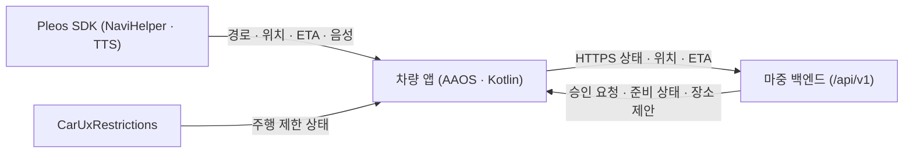

<div align="center">
  
  <h1>마중 차량 앱 (Majung Vehicle App)</h1>
  <p>Pleos Connect와 Android Automotive OS(AAOS) 환경에서 운전자가 픽업 장소를 확인하고, 초대·요청 수락과 실시간 위치·ETA 공유를 관리하는 차량용 앱입니다.</p>
  <p>
    <a href="https://github.com/majung-team/majung-vehicle-app/releases/tag/v0.2.30-preview.20261112">APK 다운로드 (0.2.30-preview)</a> ·
    <a href="https://majung.cloud/account">모바일 웹</a> ·
    <a href="https://github.com/majung-team/majung">마중 프로젝트</a> ·
    <a href="https://github.com/majung-team/majung/wiki">Wiki</a> ·
    <a href="https://github.com/majung-team/majung/blob/main/docs/development-status.md">개발 현황</a>
  </p>
</div>

> 공식 Pleos Connect 에뮬레이터(`0.2.29-preview`)를 중심으로 개발·검증 중이며, 실제 차량 주행 및 앱마켓 입점 심사는 아직 진행하지 않았습니다.

---

## 1. 주요 기능

### 차량 연결 · 픽업 초대 및 요청
- **QR 차량 연결 · 초대**: 차량 화면의 QR 코드를 휴대전화로 스캔해 운전자 계정을 연결하고, 연결된 지인을 바로 초대하거나 비회원용 QR 초대 링크를 만듭니다.
- **요청 대기열 관리**: 탑승자가 먼저 보낸 픽업 요청을 대기열로 받아 한 번에 한 건씩 진행하며, 완료 후 다음 요청을 이어갑니다.

### 내비게이션 연동 · 장소 변경
- **Pleos 내비 연동**: 내비게이션의 현재 경로, 최종 목적지, 경유지, 차량 위치, 예상 도착 시간(ETA)을 읽어 서버와 공유합니다.
- **장소 변경 원터치 수락**: 탑승자가 새 만날 장소를 제안하면 상단 헤드업 알림이나 앱 화면의 **`[수락 및 내비 변경]`** 버튼으로 내비 경유지를 재탐색하고 확정합니다(확정 전까지는 기존 장소 유지).

### 주행 안전 · 음성 안내 (TTS)
- **주행 중 요약 화면**: `CarUxRestrictions`에 따라 주행 중에는 상세 조작을 제한하고 핵심 정보와 도착·완료 버튼만 노출합니다.
- **헤드업 알림 · TTS 음성 낭독**: 내비 화면만 보는 중에도 신규 요청과 탑승자 메시지(빠른 칩·직접 입력)를 상단 알림과 기본 켜짐 TTS 음성(정차 중 설정 가능)으로 안내합니다.
- **자동 도착 감지 · 종료**: 약속 장소 반경 100m·잔여 30초 이내로 접근하면 자동 도착을 알리며, 픽업 완료·취소 시 위치 공유를 즉시 종료합니다.

### 연결 복구 · 데이터 보호
- **강제 종료 후 재개 확인**: 앱이 비정상 종료된 뒤 다시 켜지면 서버 상태와 저장된 세션을 확인해 운전자 확인 후 안전하게 이어가거나 취소합니다.
- **암호화 저장**: 픽업 복구에 필요한 세션 자격증명은 Android Keystore에 암호화해 보관합니다.

---

## 2. 시스템 구성 및 기술 스택



### 패키지 구조

```text
vehicle/src/main/java/app/majung/vehicle/
├── MainActivity.kt              # 화면 생명주기 및 루트 UI
├── VehicleApplication.kt        # 전역 초기화 및 의존성 구성
├── ui/sections/                 # 계정 · 픽업 생성 · 요청 · 초대 · 주행 요약 화면
├── navi/                        # Pleos NaviHelper SDK 연동 · 경로 검증 · 텔레메트리
├── domain/                      # 픽업 컨트롤러 · 권한 · 주행 제한 · 장소 변경 상태
├── data/                        # 백엔드 HTTPS API 클라이언트 및 Keystore 암호화 저장소
├── service/                     # 백그라운드 위치·ETA 공유 포그라운드 서비스
└── util/                        # Pleos TTS 음성 안내 · QR 생성 · 헤드업 알림

probe/                           # Pleos SDK 동작 확인용 진단 모듈 (일반 배포 제외)
```

### 기술 스택

| 구분 | 구성 |
| --- | --- |
| **플랫폼 · 언어** | Kotlin · Android Automotive OS (minSdk 28 · targetSdk 34) · Java 17(JDK 25) |
| **차량 SDK** | Pleos NaviHelper 3.0.5 · Pleos TextToSpeech 3.3.1 · `android.car` (`CarUxRestrictions`) |
| **QR · 보안** | ZXing Core 3.5.3 · Android Keystore 암호화 저장소 |
| **배포 · 검증** | GitHub Releases 서명 APK · JUnit · Android Lint |

---

## 3. 검증 범위 및 제한 사항

| 구분 | 범위 |
| --- | --- |
| **에뮬레이터 · 단위 검증** | 단위 테스트·Android Lint, Pleos 공식 에뮬레이터(`0.2.29-preview` 시연 · `0.2.30-preview` 설치 및 QR 자동 확인 팝업 반영) 기반 경로·ETA·TTS·장소 변경·강제 종료 후 재개 및 대기 픽업 경유지 검증 |
| **실환경 별도 확인** | 실제 차량 주행 및 스피커 출력(통화 우선순위 포함), 실차 주행 제한, 시동 OFF/ON 복구, 실기기 간 E2E 흐름, 앱마켓 심사 |

- **알려진 제한 사항**: 에뮬레이터에서 SDK 경유지 원본 좌표 `0` 응답 우회 적용([이슈 #13](https://github.com/majung-team/majung-vehicle-app/issues/13)), 가독성 기기 시험 종료 시 `ActivityScenario` PAUSED 대기([이슈 #116](https://github.com/majung-team/majung-vehicle-app/issues/116))

---

## 4. 상세 문서 및 관련 저장소

| 분류 | 문서 |
| --- | --- |
| **화면 · 기능** | [화면과 사용 순서](docs/service-screens.md) · [QR 최초 연결](docs/vehicle-enrollment.md) · [요청 및 다음 픽업](docs/request-pickup-flow.md) · [계정 및 요청](docs/vehicle-account-requests.md) · [음성 안내](docs/pickup-voice.md) |
| **내부 · SDK** | [차량 화면 구조](docs/vehicle-screen.md) · [저장 및 복구](docs/pickup-recovery.md) · [백그라운드 공유](docs/background-sharing.md) · [주행 중 요약 화면](docs/driving-summary.md) · [Release 서명](docs/release-signing.md) |
| **프로젝트 공통** | [전체 아키텍처](https://github.com/majung-team/majung/blob/main/docs/architecture.md) · [개발 현황](https://github.com/majung-team/majung/blob/main/docs/development-status.md) · [시연 영상](https://github.com/majung-team/majung/blob/main/docs/pickup-demo.md) · [팀 테스트 안내](https://github.com/majung-team/majung/blob/main/docs/team-testing.md) · [기여 가이드](CONTRIBUTING.md) |

| 저장소 | 역할 |
| --- | --- |
| [majung](https://github.com/majung-team/majung) | 전체 서비스 소개 · 설계 · 시연 |
| [majung-vehicle-app](https://github.com/majung-team/majung-vehicle-app) | AAOS 차량 앱 및 Pleos SDK 연동 |
| [majung-web](https://github.com/majung-team/majung-web) | 운전자 · 탑승자 모바일 웹 |
| [majung-ios](https://github.com/majung-team/majung-ios) | SwiftUI iOS 모바일 앱 |
| [majung-backend](https://github.com/majung-team/majung-backend) | Spring Boot API 및 운영 배포 |
