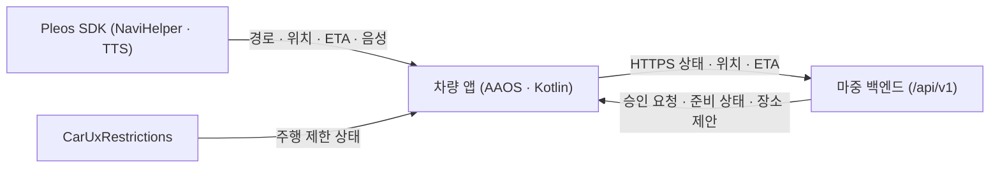

<div align="center">
  
  <h1>마중 차량 앱 (Majung Vehicle App)</h1>
  <p>Pleos Connect와 Android Automotive OS(AAOS) 환경에서 운전자가 픽업 장소를 확인하고, 초대·요청 수락과 실시간 위치·ETA 공유를 관리하는 차량용 앱입니다.</p>
  <p>
    <a href="https://github.com/majung-team/majung-vehicle-app/releases/tag/v0.2.34-preview.20261113">APK 다운로드 (0.2.34-preview)</a> ·
    <a href="https://majung.cloud/account">모바일 웹</a> ·
    <a href="https://github.com/majung-team/majung">마중 프로젝트</a> ·
    <a href="https://github.com/majung-team/majung/wiki">Wiki</a> ·
    <a href="https://github.com/majung-team/majung/blob/main/docs/development-status.md">개발 현황</a>
  </p>
</div>

> 공식 Pleos Connect 에뮬레이터(`0.2.34-preview`)를 중심으로 개발·검증 중이며, 실제 차량 주행 및 앱마켓 입점 심사는 아직 진행하지 않았습니다.

---

## 1. 주요 기능

### 차량 연결 · 픽업 초대 및 요청
- **QR 차량 연결 · 초대**: 차량 화면의 QR 코드를 휴대전화로 스캔해 운전자 계정을 연결하고, 연결된 지인을 바로 초대하거나 비회원용 QR 초대 링크를 만듭니다.
- **요청 대기열 관리**: 탑승자가 먼저 보낸 픽업 요청을 대기열로 받아 한 번에 한 건씩 진행하며, 완료 후 다음 요청을 이어갑니다.

### 내비게이션 연동 · 장소 변경
- **Pleos 내비 연동**: 내비게이션의 현재 경로, 최종 목적지, 경유지, 차량 위치, 예상 도착 시간(ETA)을 읽어 서버와 공유합니다.
- **장소 변경 원터치 수락**: 탑승자가 새 만날 장소를 제안하면 상단 헤드업 알림이나 앱 화면의 **`[수락 및 내비 변경]`** 버튼으로 내비 경유지를 재탐색하고 확정합니다(확정 전까지는 기존 장소 유지).

### 주행 안전 · 음성 안내 (TTS)
- **주행 중 요약 화면**: `CarUxRestrictions`에 따라 주행 중에는 상세 조작을 제한하고 핵심 정보와 도착·완료 버튼만 노출합니다.
- **헤드업 알림 · TTS 음성 낭독**: 내비 화면만 보는 중에도 신규 요청·장소 제안·탑승자 메시지(빠른 칩·직접 입력)를 상단 헤드업 알림과 기본 켜짐 TTS 음성(정차 중 설정 가능)으로 안내하며, 빠른 메시지 확인 시에는 내비 화면에서 벗어나지 않고 알림만 닫힙니다.
- **자동 도착 감지 · 종료**: 약속 장소 반경 100m·잔여 30초 이내로 접근하면 자동 도착을 알리며, 픽업 완료·취소 시 위치 공유를 즉시 종료합니다.

### 연결 복구 · 데이터 보호
- **강제 종료 후 재개 확인**: 앱이 비정상 종료된 뒤 다시 켜지면 서버 상태와 저장된 세션을 확인해 운전자 확인 후 안전하게 이어가거나 취소합니다.
- **암호화 저장**: 픽업 복구에 필요한 세션 자격증명은 Android Keystore에 암호화해 보관합니다.

---

## 2. 시스템 구성 및 기술 스택



### 패키지 구조

```text
vehicle/src/main/java/app/majung/vehicle/
├── MainActivity.kt              # 화면 생명주기 및 루트 UI
├── VehicleApplication.kt        # 전역 초기화 및 의존성 구성
├── ui/sections/                 # 계정 · 픽업 생성 · 요청 · 초대 · 주행 요약 화면
├── navi/                        # Pleos NaviHelper SDK 연동 · 경로 검증 · 텔레메트리
├── domain/                      # 픽업 컨트롤러 · 권한 · 주행 제한 · 장소 변경 상태
├── data/                        # 백엔드 HTTPS API 클라이언트 및 Keystore 암호화 저장소
├── service/                     # 백그라운드 위치·ETA 공유 포그라운드 서비스
└── util/                        # Pleos TTS 음성 안내 · QR 생성 · 헤드업 알림

probe/                           # Pleos SDK 동작 확인용 진단 모듈 (일반 배포 제외)
```

### 기술 스택

| 구분 | 구성 |
| --- | --- |
| **플랫폼** | Kotlin · Android Automotive OS<br>`minSdk 28` · `targetSdk 34` · Java 17 (JDK 25) |
| **SDK** | Pleos `NaviHelper 3.0.5` · `TextToSpeech 3.3.1`<br>`android.car` (`CarUxRestrictions`) |
| **QR·보안** | ZXing Core 3.5.3 · Android Keystore 암호화 |
| **배포** | GitHub Releases 서명 APK · JUnit · Android Lint |

---

## 3. 실행 방법 · 테스트 환경 · 검증 범위

> [!IMPORTANT]
> **기본 내비 실행 제한 · 2026년 11월 12일 관찰**: Pleos Connect 2.1.0의 Navi42 `3.3.2-rc5-hotfix.3`이 지도 인증 응답의 `profile` 항목을 처리하지 못해 지도 초기화에 실패하는 현상을 확인했다. 마중을 실행하지 않은 콜드부팅에서도 재현됐다. 마중 APK 재설치나 NaviHelper 버전 변경으로 해결됐다고 확인한 상태는 아니며, 수정된 내비 APK·에뮬레이터 이미지와 적용 방법을 운영사무국에 문의했다. 11월 10일 정상 시연 기록과 이후 관찰한 환경 오류를 구분한다. [증상과 확인 범위](https://github.com/majung-team/majung-vehicle-app/blob/main/docs/navigation-environment.md).

### APK 위치 및 실행 방법
- **저장소 APK 파일**: [`apk/마중_마중_release.apk`](apk/마중_마중_release.apk) (`0.2.34-preview`, `versionCode 36`, 정식 서명)
- **GitHub Releases**: [v0.2.34-preview.20261113](https://github.com/majung-team/majung-vehicle-app/releases/tag/v0.2.34-preview.20261113)

```sh
# 1) Pleos Connect v2.1.0 에뮬레이터에 Release APK 설치 및 실행
adb install -r apk/마중_마중_release.apk

# 2) 소스 빌드 및 단위 테스트 / 린트 실행
./gradlew :vehicle:testDebugUnitTest :vehicle:lintDebug :vehicle:assembleDebug --no-daemon
```

1. 에뮬레이터에서 마중 앱을 실행하면 차량 연결 QR 코드가 표시됩니다.
2. 휴대전화 브라우저로 QR을 스캔하거나 [`https://majung.cloud/account`](https://majung.cloud/account)에 카카오 로그인해 차량을 연결합니다.
3. 다른 카카오 계정(탑승자)으로 픽업을 요청하거나 차량에서 초대 링크를 생성해 전체 픽업 흐름을 확인할 수 있습니다.

### 테스트 환경 및 필요한 설정
- **빌드 · 실행 요구사항**: `minSdk 28` / `targetSdk 34`, Gradle, Java 17(JDK 25)
- **백엔드 연결**: 별도 서버 키 설정 없이 공개 운영 서버(`https://majung.cloud`)로 기본 연결되며, 저장소에 비밀값이나 keystore를 포함하지 않습니다.
- **필요 준비물**: Pleos Connect 공식 에뮬레이터(`NaviHelper 3.0.5`, `TextToSpeech 3.3.1` 탑재), 카카오 계정 2개(운전자·탑승자), 위치 권한 허용

| 구분 | 범위 |
| --- | --- |
| **에뮬레이터** | `Pleos Connect v2.1.0` (`Android 14`, `arm64-v8a`)<br>`Pleos_Connect_v2_0` · `2560 × 1440 px` (`160 dpi`)<br>SDK `NaviHelper 3.0.5` · `TextToSpeech 3.3.1` |
| **확인&nbsp;완료** | 단위 테스트(72)·Lint · 에뮬레이터(`0.2.29` 시연·`0.2.34` 설치)<br>QR 팝업 · 내비 알림 유지 · 경로·ETA·TTS · 재개 복구 |
| **실차&nbsp;확인** | 실차 주행 · 스피커/통화 우선순위 · 주행 제한<br>시동 OFF/ON 복구 · 실기기 E2E · 앱마켓 심사 |

---

## 4. 상세 문서 및 관련 저장소

| 분류 | 문서 |
| --- | --- |
| **화면&nbsp;·&nbsp;기능** | [화면과 사용 순서](docs/service-screens.md) · [QR 최초 연결](docs/vehicle-enrollment.md)<br>[요청 및 다음 픽업](docs/request-pickup-flow.md) · [계정 및 요청](docs/vehicle-account-requests.md) · [음성 안내](docs/pickup-voice.md) |
| **내부&nbsp;·&nbsp;SDK** | [차량 화면 구조](docs/vehicle-screen.md) · [저장 및 복구](docs/pickup-recovery.md)<br>[백그라운드 공유](docs/background-sharing.md) · [주행 중 요약 화면](docs/driving-summary.md) · [Release 서명](docs/release-signing.md) |
| **프로젝트&nbsp;공통** | [전체 아키텍처](https://github.com/majung-team/majung/blob/main/docs/architecture.md) · [개발 현황](https://github.com/majung-team/majung/blob/main/docs/development-status.md) · [시연 영상](https://github.com/majung-team/majung/blob/main/docs/pickup-demo.md)<br>[팀 테스트 안내](https://github.com/majung-team/majung/blob/main/docs/team-testing.md) · [Wiki 기술 회고](https://github.com/majung-team/majung/wiki#%EA%B8%B0%EC%88%A0-%ED%9A%8C%EA%B3%A0) · [기여 가이드](CONTRIBUTING.md) |

| 저장소 | 역할 |
| --- | --- |
| [majung](https://github.com/majung-team/majung) | 전체 서비스 소개 · 설계 · 시연 |
| [majung-vehicle-app](https://github.com/majung-team/majung-vehicle-app) | AAOS 차량 앱 및 Pleos SDK 연동 |
| [majung-web](https://github.com/majung-team/majung-web) | 운전자 · 탑승자 모바일 웹 |
| [majung-ios](https://github.com/majung-team/majung-ios) | SwiftUI iOS 모바일 앱 |
| [majung-backend](https://github.com/majung-team/majung-backend) | Spring Boot API 및 운영 배포 |
