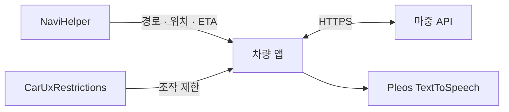

<div align="center">
  
  <h1>마중 차량 앱</h1>
  <p>내비를 보는 동안에도, 기다리는 사람의 준비 상태를 알 수 있도록.</p>
  <p><a href="https://github.com/majung-team/majung-vehicle-app/releases">서명 APK</a> · <a href="https://github.com/majung-team/majung/blob/main/docs/pickup-demo.md">시연 영상</a> · <a href="https://github.com/majung-team/majung">서비스 소개</a> · <a href="https://github.com/majung-team/majung/wiki">기술 회고</a></p>
</div>

## 운전자는 내비를 계속 본다

탑승자가 ‘지금 내려가요’를 보내면 내비 화면 위 알림과 Pleos 음성 안내로 전달한다. 메시지의 **확인**은 알림만 닫아 길안내를 유지한다. 장소 변경 제안은 **수락 및 내비 변경**으로 경로를 바꾸고 실제 반영 결과를 확인한다.

새 마중 요청의 **요청 확인**은 마중 앱을 연다. 새 요청을 알림에서 바로 수락해 픽업을 시작하는 기능과, 이미 진행 중인 픽업의 장소 제안 수락은 서로 다르다.

| 상황 | 차량 앱의 처리 |
| --- | --- |
| 처음 연결 | 휴대전화로 차량 QR을 열고 요청한 계정을 차량에서 확인 |
| 픽업 만들기 | 내비 목적지·경유지 확인 후 지인 또는 링크로 초대 |
| 탑승자가 먼저 요청 | 수락해 대기열에 추가, 차례가 되면 경로 준비 후 시작 |
| 내비로 화면 이동 | 시작한 위치·도착 시간 공유 유지 |
| 주행 중 | 차량 UX 제한에 따라 조작 화면을 닫고 읽기 전용 요약 표시 |
| 탑승 완료·취소 | 위치 공유와 픽업 접근 정보 정리 |

주행 중 도착·완료 버튼을 누르는 방식이 아니다. 차량이 조작을 허용하는 상태에서 운전자가 탑승 완료를 확인한다. 도착은 내비 목표 일치·거리·남은 시간 조건을 함께 사용하며, 도착 시간이 0이라고 탑승까지 자동 완료하지 않는다.

## 내비 응답을 그대로 믿을 수 없을 때

- **경유지 좌표 누락** — `(0, 0)` 응답은 장소 식별자가 한 건씩 일치할 때만 알고 있는 좌표로 보완한다. 확인할 수 없으면 재선택을 안내한다.
- **경로 변경 도중 화면 이동** — 경유지 추가 작업이 끝나기 전에 내비 연결을 끊지 않도록 처리한다.
- **앱 강제 종료 후 복구** — 저장된 픽업으로 서버 상태를 먼저 확인하고, 운전자가 재개한 뒤 새 내비 정보를 전송한다. 좌표·ETA를 저장해 그대로 다시 보내지 않는다.

[경유지 좌표 처리](docs/waypoint-coordinates.md) · [픽업 저장·복구](docs/pickup-recovery.md) · [백그라운드 공유](docs/background-sharing.md)

## 설치와 첫 연결

최신 게시 APK는 **0.2.36-preview · versionCode 38**이다. [Releases](https://github.com/majung-team/majung-vehicle-app/releases/tag/v0.2.36-preview.20261115) 또는 [`apk/마중_마중_release.apk`](apk/마중_마중_release.apk)에서 받는다.

```sh
adb install -r apk/마중_마중_release.apk
```

1. Pleos 에뮬레이터에서 마중을 실행하고 필요한 위치 권한을 허용한다.
2. 차량 QR을 휴대전화로 열어 카카오 계정을 연결한다.
3. 지인을 초대하거나, 탑승자가 웹에서 보낸 요청을 차량에서 확인한다.

게시된 Release APK는 `https://majung.cloud`에 연결된다. 직접 빌드하는 Debug 앱의 기본 주소는 로컬 서버이므로 운영 서버를 쓰려면 아래처럼 지정한다.

```sh
./gradlew :vehicle:assembleDebug -PpickupApi=https://majung.cloud --no-daemon
./gradlew :vehicle:testDebugUnitTest :vehicle:lintDebug --no-daemon
```

Android SDK 34와 JDK 25를 사용하며 Java 17 대상으로 컴파일한다. Pleos 의존성 저장소 설정은 [settings.gradle.kts](settings.gradle.kts), 서명 키 설정은 [Release 서명 안내](docs/release-signing.md)에서 확인한다. Release 서명 키는 저장소에 포함하지 않는다.

## 구조와 사용 기술



| 구성 | 역할 |
| --- | --- |
| Kotlin · AAOS, minSdk 28 / targetSdk 34 | 차량 화면과 Android 서비스 |
| NaviHelper 3.0.5 · TextToSpeech 3.3.1 | 내비 경로·위치·도착 시간, 음성 안내 |
| Android Keystore · ZXing | 픽업 접근 정보 암호화, QR 생성 |

<details>
<summary>소스에서 기능 찾기</summary>

`vehicle/src/main/java/app/majung/vehicle/` 기준이다.

- `ui/sections/` — 연결·요청·초대·픽업·주행 요약 화면
- `navi/` — SDK 연결·경로 확인·좌표와 ETA 처리
- `domain/` — 픽업 상태·공유 시작·주행 제한
- `service/` — 화면 밖 위치 공유와 알림 동작
- `data/` — API 통신과 암호화 저장소
- `util/` — 음성·QR·알림 정책
- `probe/` 모듈 — SDK 진단용, 일반 배포 제외

</details>

## 시험 환경과 남은 범위

공식 **Pleos Connect 2.1.0 · Android 14/API 34 · arm64-v8a · 2560×1440px/160dpi**에서 개발한다. 단위 시험·Lint·컴파일은 [Android CI](https://github.com/majung-team/majung-vehicle-app/actions)에서, SDK를 사용하는 기기 시험은 에뮬레이터에서 별도로 확인한다.

> 11월 12일 기본 내비 자체의 지도 초기화 실패를 관찰했다. 마중 APK나 SDK 버전 변경으로 해결된 상태로 안내하지 않는다. [내비 환경과 문의 기록](docs/navigation-environment.md)

[11월 10일 시연](https://github.com/majung-team/majung/blob/main/docs/pickup-demo.md)은 `0.2.29-preview` 기준이다. 최신 APK 설치·공유 확인 기록과 촬영 기록을 구분하며, 실차 주행·시동 OFF/ON·차량 스피커와 통화 간 음성 우선순위는 별도 확인 범위다.

[화면과 사용 순서](docs/service-screens.md) · [주행 요약](docs/driving-summary.md) · [음성 안내](docs/pickup-voice.md) · [요청 대기열](docs/request-pickup-flow.md) · [개발 기록](https://github.com/majung-team/majung/blob/main/docs/development-status.md) · [기여 가이드](CONTRIBUTING.md)
