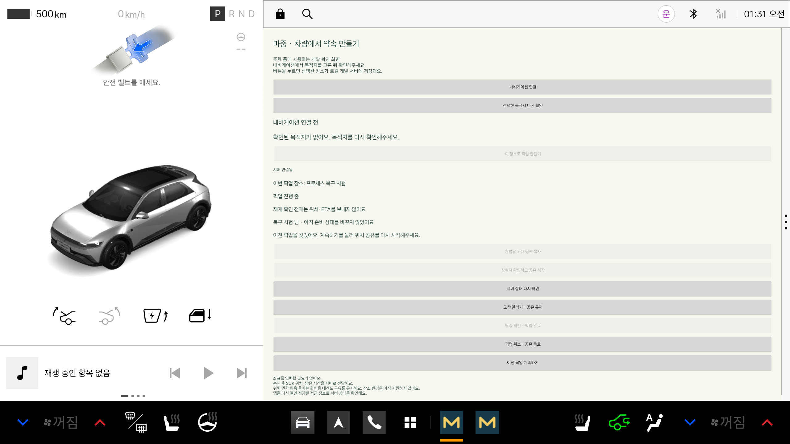

# 화면 밖 위치·ETA 공유

기능: 3.2 백그라운드 전송 · 승준 2번. 9.2 재실행 복구의 재개 확인도 함께 연결한다.

## 사용 흐름

1. 주차 중 차량 화면에서 목적지를 확인하고 픽업을 만든다.
2. 탑승자 참여를 승인한다. 위치 권한이 없으면 ‘화면 밖에서도 공유 시작’을 누르고 허용한다.
3. 진행 중에는 ‘마중 · 픽업 공유 중’ 알림을 표시한다. 화면을 내리거나 다른 앱으로 이동해도 서비스가 SDK 연결과 전송을 유지한다.
4. 도착을 알려도 탑승 확인 전까지 공유한다. 탑승 완료·취소·만료를 확인하면 서비스·SDK 연결·알림을 종료한다.

위치 권한을 거절하면 위치·ETA를 보내지 않는다. 픽업 자체는 유지하며 화면에서 다시 권한을 요청하거나 픽업을 취소할 수 있다.
알림 권한 거절은 Android의 서비스 실행 조건과 별개다. 알림 권한이 없으면 일반 알림 서랍에 보이지 않을 수 있다.

## 화면 종료와 프로세스 종료의 차이

| 상황 | 처리 |
| --- | --- |
| Activity만 멈춤 | 실행 중인 서비스가 공유 유지 |
| SDK 연결 종료·자료 갱신 중단 | 최신 자료가 없으면 이전 위치·ETA 삭제 요청. 서버의 만료 처리도 함께 적용 |
| 앱 프로세스 종료·강제 중지 | 자동 재실행하지 않음. 서버 픽업을 취소하는 것으로 간주하지 않음 |
| 앱 다시 실행 | 암호화된 접근 정보로 서버 상태 확인. 진행 중이면 ‘이전 픽업 계속하기’ 표시 |
| 계속하기 선택 | 새 SDK 자료를 받은 뒤 전송 재개. 저장해 둔 위치 재전송 없음 |
| 종료 선택 | 기존 ‘픽업 취소’ 확인 창으로 서버 픽업 종료 |
| 서버가 이미 완료·취소·만료 | 복구하지 않고 접근 정보 삭제 |

시동 OFF 이벤트를 직접 감지하는 기능은 아직 없다. SDK 연결 종료와 시동 OFF는 같은 사건으로 단정할 수 없다.
앱 재접속 시 경로 안내를 자동 재시작하지 않는다. 플랫폼이 허용하는 내비게이션 제어 범위를 별도로 확인해야 한다.
탑승자 웹의 ‘갱신 중단·마지막 갱신 시각’ 표시는 웹 작업과 함께 확인할 항목이다.

## 실행 구조

- `MainActivity`: 사용자에게 위치 권한 요청. 화면이 보이는 동안 승인된 픽업의 서비스 시작. 화면 갱신만 유지한다.
- `PickupSharingService`: location Foreground Service. 서버 상태 3초 조회, SDK 5초 조회, 최신 자료 전송을 담당한다.
- `PickupController`: 화면 콜백과 서비스 관찰자를 별도로 관리한다. 완료·취소·만료 시 서비스도 종료를 감지한다.
- `VehicleApplication`: 같은 SDK reader와 controller를 화면·서비스에 제공한다. SDK 콜백 전송은 서비스 실행 중에만 허용한다.

경로 재요청 후 완료 콜백이 없어도 현재 경로와 목적지를 다시 확인한다. 확인 순서와 SDK 값의 제약은 [경로 재요청 후 공유 복구](route-recovery.md)에 정리했다.

정상 자료 전송 간격은 최소 5초다. 차량이 정차해 값이 같아도 최근 10초 이내에 받은 SDK 자료면 다음 순번으로 보낸다.
`sourceTime`은 SDK 자료를 받은 시각을 그대로 사용한다. 전송할 때 현재 시각으로 덮어쓰지 않는다.
SDK 자료가 오래되거나 목적지가 달라지면 정상 heartbeat를 보내지 않는다. 이전 자료 삭제는 실패 시 3초 간격으로 재시도한다.
네트워크가 느리면 겹쳐 보내지 않고 이전 요청이 끝난 후 재시도한다. 5초 도착을 보장하는 방식은 아니다.

## Android 권한

`FOREGROUND_SERVICE`, `FOREGROUND_SERVICE_LOCATION`, 위치 runtime 권한을 선언한다.
Android 14의 location 서비스 조건에 따라 사용자가 앱을 보고 있을 때 시작한다. `ACCESS_BACKGROUND_LOCATION`은 요청하지 않는다.
실제 위치는 기존 Pleos `NAVI_ROUTE` SDK에서 받는다. Android 위치 권한을 받은 것만으로 차량 SDK 접근 권한이 생기는 것은 아니다.
서비스는 exported=false이며 알림에는 위치·장소·토큰을 넣지 않는다.

공식 근거: [서비스 유형과 location 실행 조건](https://developer.android.com/develop/background-work/services/fgs/service-types#location),
[Foreground Service 시작 제한](https://developer.android.com/develop/background-work/services/fgs/launch).

## 검증

공식 Pleos 에뮬레이터와 같은 Mac의 로컬 API를 사용한다. 실차 절전·시동 OFF/ON·스토어 승인·공개 HTTPS 서버 시험과 구분한다.

```sh
./gradlew :vehicle:testDebugUnitTest :vehicle:assembleDebug :vehicle:assembleDebugAndroidTest :vehicle:lintDebug
# 개발 시험에 한해 권한을 미리 부여한다. 일반 사용자는 앱의 권한 창에서 허용한다.
adb shell pm grant --user 10 app.majung.vehicle android.permission.ACCESS_FINE_LOCATION
adb shell pm grant --user 10 app.majung.vehicle android.permission.ACCESS_COARSE_LOCATION
adb shell pm grant --user 10 app.majung.vehicle android.permission.POST_NOTIFICATIONS
adb shell am instrument --user 10 -w -e class app.majung.vehicle.PickupSharingServiceTest \
  app.majung.vehicle.test/androidx.test.runner.AndroidJUnitRunner
```

5분 시험은 실제 SDK 목적지·위치·ETA를 사용한다. Activity를 CREATED로 내려 onStop 이후 310초 동안 서버의 freshness와 순번 증가를 확인한다.
서버 측 취소 후 화면을 다시 열지 않고 서비스·저장 정보가 정리되는지도 확인한다.

### 확인 결과

- Activity를 멈춘 뒤 310초 동안 FRESH 유지, 5초 간격 관측에서 순번 증가 61회 확인. 서버 취소 후 서비스 종료·암호화 저장 삭제 확인.

- 위치 권한 미부여: ACTIVE가 되어도 서비스 미실행, 전송 순번 0 유지, 서버 좌표·ETA 없음 확인.
- 기존 SDK 흐름 2개와 Keystore·복구 4개 통과. 강제 중지 전·후 두 프로세스 시험도 각각 통과.
- 복구 화면의 계속하기 버튼과 확인 전 전송 차단 확인. 합성 장소·ETA를 쓰는 복구 시험은 실제 SDK 시험과 구분한다.
- 단위 시험 8개, debug APK·시험 APK 빌드·lint 통과.
- 서버 EXPIRED 응답의 서비스 중단 분기는 연결했지만, 실제 시간 경과 만료를 기다리는 장시간 시험은 이번에 수행하지 않았다.



위 화면은 합성 장소로 만든 복구 시험이다. 실제 차량의 시동 OFF/ON 시험 화면이 아니다.
