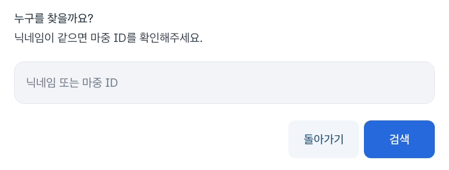

# 팝업 버튼과 연결 상태 새로고침

2026년 10월 28일 · 차량 앱 0.2.10-preview

검색 팝업의 버튼 위쪽이 잘려 보였다. 에뮬레이터에서 실제 좌표를 확인하니
버튼의 top이 부모 영역보다 4px 위에 있었다. 기본 ButtonBarLayout의 기준선 정렬을 끄고,
버튼 영역의 높이와 안쪽 간격을 맞췄다. 같은 스타일을 쓰는 QR·확인·취소 팝업에도 적용한다.

운전자 연결 상태를 다시 확인할 때는 기존 계정 정보를 유지하고 버튼에
‘새로운 정보 확인 중…’을 표시한다. 조회 중 버튼 색을 비활성화 색으로 바꾸지 않으며,
반복해서 눌러도 조회를 중복 실행하지 않는다. 계정 조회 콜백은 계정 영역만 갱신한다.
메뉴 이동 효과를 새로 시작하거나 내비·픽업 영역 전체를 갱신하지 않는다.

확인 범위:

- 독립 Pleos 에뮬레이터의 검색 팝업에서 양쪽 버튼이 부모 영역 안에 표시되는지 검사
- 응답을 500ms 늦춘 시험 서버로 새로고침 중 기존 정보·버튼 위치·스크롤 유지 확인
- 연속 클릭 시 조회 한 번만 실행하고, 성공 후 원래 버튼 문구로 복귀하는지 확인
- 차량 계정·픽업 복구·주행 요약 시험 11건 실행, 별도 실제 P→D→P 시험 1건은 조건부 건너뜀
- 단위 테스트와 lint 통과

이는 시험 서버를 사용한 에뮬레이터 확인이다. 사용자가 본 일시적인 지연 전체의 원인이나
실제 휴대전화·실차에서의 표시 성능까지 확인한 것은 아니다.
