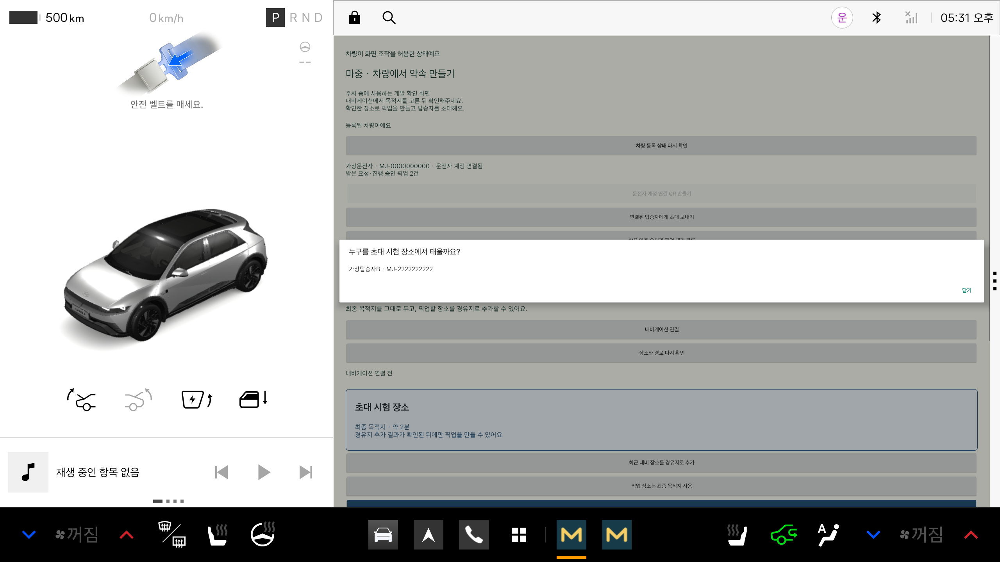

# 연결된 탑승자에게 바로 초대

운전자 계정과 차량을 처음 한 번 연결하고, 휴대전화의 ‘내 연결’에서 상대와 연결을 수락해 둔다.
차량에서 내비 장소를 확인한 뒤 ‘연결된 탑승자에게 초대 보내기’로 사람을 선택한다.
이후에는 QR을 다시 찍거나 운전자 휴대전화로 링크를 전달할 필요가 없다.

탑승자는 마중 웹 `/account`에서 장소를 보고 수락·거절한다. 수락한 초대는 기존 픽업 대기열에 들어간다.
차량의 ‘받은 마중 요청과 픽업 대기 목록’에서 수락 상태를 확인하고 순서대로 시작한다.
해당 장소가 이미 내비 경로에서 확인됐다면 다시 추가할 필요는 없다.

- 장소 확인과 사람 선택·전송은 정차 상태에서만 가능하다.
- 수락 전에는 차량 위치를 공유하지 않는다. 수락 후에도 내 픽업이 시작돼야 위치를 볼 수 있다.
- 응답 대기는 30분, 수락한 픽업 대기는 2시간이다. 수락 순서대로 진행한다.
- 보낸 초대는 차량에서 취소할 수 있다. 연결 해제·만료된 초대는 수락할 수 없다.
- 통신 오류가 나도 자동으로 초대를 다시 보내지 않는다. 같은 사람·장소에 명시적으로 다시 보내면 기존 초대 번호를 재사용한다.
- 처음 연결하는 사람에게는 기존 QR 초대를 쓸 수 있다.

웹을 닫아둔 동안의 푸시 알림은 아직 지원하지 않는다. 탑승자가 마중 웹을 열어 확인해야 한다.

## 확인한 범위

차량 계정 계측 테스트 4개 통과. 연결 목록 조회, 차량 권한 사용, 전송 실패 후 자동 재전송 없음,
명시적 재전송 시 같은 초대 번호 사용, 정차 상태의 사람 선택 화면을 확인했다.
아래 화면의 사람과 장소는 시험용이다. SDK 경로 응답을 입력한 실제 주행 시험은 아니다.
서버의 수락·대기열 처리와 브라우저의 수락 화면은 각 저장소에서 따로 검증했다.
실제 휴대전화·실차 시험은 별도다.

