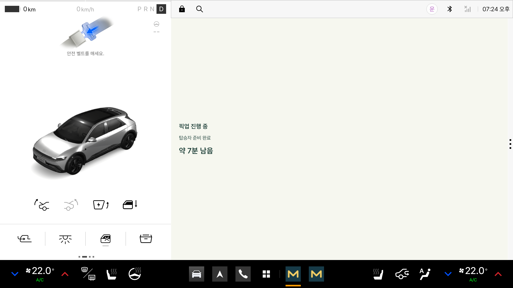

# 주행 중 픽업 요약 화면

마중 차량 앱은 차량 시스템의 주행 제한 상태에 따라 상세 조작 화면과 읽기 전용 픽업 요약 화면을 전환한다.

주행 제한이 적용되면 픽업 진행 상태, 탑승자 준비 상태, 남은 시간 등 필요한 정보만 표시한다. QR코드, 설정, 요청 목록 및 조작 버튼은 숨긴다.

이 문서는 주행 제한 처리 방식과 공식 Pleos 에뮬레이터의 화면 전환 시험 결과를 정리한 기록이다.

> 마중은 기어 위치나 차량 속도로 주행 가능 여부를 직접 판단하지 않는다. `CarUxRestrictionsManager`가 제공하는 제한 상태와 변경 알림을 따른다.

---

## 1. 주행 중 화면 구성

주행 제한 상태에서는 정차용 화면 전체를 숨기고 읽기 전용 요약 화면을 표시한다.

### 표시하는 정보

- 현재 픽업 진행 상태
- 탑승자 준비 상태
- 유효한 예상 도착 시간(ETA)
- 공유 중단 또는 연결 확인 안내
- 도착 및 종료 상태

### 표시하지 않는 정보

- 픽업 생성 및 초대 버튼
- QR코드와 등록 코드
- 운전자 계정 및 설정
- 받은 요청 및 대기열
- 사람 이름과 마중 ID
- 위치 좌표
- 입력창 및 스크롤 가능한 조작 화면

기존에 열려 있던 확인창도 주행 제한이 적용되면 닫는다.

### 주행 제한 화면



화면에 표시된 픽업 상태, 준비 상태 및 7분 ETA는 시험 데이터다.

다만 정차 화면에서 읽기 전용 화면으로 전환되는 동작은 공식 Pleos 에뮬레이터의 실제 주행 제한 상태를 사용해 확인했다.

---

## 2. 픽업 상태별 표시 기준

현재 픽업 상태와 차량 정보의 유효성에 따라 요약 화면을 구성한다.

| 상태 | 표시 내용 | 처리 기준 |
| --- | --- | --- |
| `ACTIVE` | 픽업 진행·준비 상태·남은 시간 | SDK 정보가 유효한 경우에만 ETA 표시 |
| `ARRIVED` | 도착 안내·준비 상태 | 탑승 완료 조작은 정차 후 진행 |
| 서버 연결 실패 | 연결 확인 안내 | 이전 준비 상태와 ETA 숨김 |
| 앱 복구 대기 | 픽업 확인 안내 | 공유 재개 전 이전 상태 숨김 |
| 공유 중단 | 공유 중단 안내 | 이전 ETA 표시하지 않음 |
| SDK 정보 만료 | 남은 시간 확인 안내 | 유효하지 않은 ETA 제거 |
| 완료·취소·만료 | 픽업 종료 안내 | 이전 위치·ETA 사용하지 않음 |

### 진행 중인 픽업

`ACTIVE` 상태에서는 픽업 진행 상태와 탑승자 준비 상태를 표시한다.

남은 시간은 다음 조건을 모두 충족한 경우에만 보여준다.

1. 위치 공유가 진행 중인 상태
2. SDK에서 유효한 차량 위치 수신
3. 현재 목적지에 대한 유효한 ETA 수신
4. 위치와 ETA 모두 최근 10초 이내 수신

조건을 충족하지 못하면 이전 ETA를 계속 표시하지 않는다.

### 도착 상태

`ARRIVED` 상태에서는 도착 안내와 탑승자 준비 상태를 표시한다.

도착과 탑승 완료는 별개의 상태다.

탑승 확인은 주행 제한이 해제된 상태에서 진행한다.

ETA가 0초가 되더라도 앱이 임의로 도착 상태를 확정하지 않는다.

### 연결 실패 및 복구 대기

서버 연결이 끊겼거나 앱 재실행 후 픽업 확인이 진행 중인 경우에는 이전 준비 상태와 ETA를 숨긴다.

새로운 서버 상태와 유효한 SDK 정보를 확인하기 전까지 과거 데이터를 현재 정보처럼 사용하지 않는다.

---

## 3. 주행 제한 처리 구조

### CarUxRestrictionsManager

차량 앱은 `CarUxRestrictionsManager`를 통해 현재 제한 상태를 확인하고 변경 알림을 수신한다.

다음 정보만으로 자체적인 주행 제한 상태를 결정하지 않는다.

- P·D 등 기어 표시
- 차량 속도
- 내비게이션 경로 안내 여부

기어 조작은 공식 에뮬레이터에서 제한 상태 변화를 발생시키기 위한 시험 수단이며, 앱의 직접적인 판단 기준이 아니다.

### 차량 상태를 확인할 수 없는 경우

시스템의 차량 상태를 확인하지 못한 경우에도 정차용 조작 화면을 열지 않는다.

확인되지 않은 상태를 조작 가능한 상태로 가정하지 않는 방식이다.

### 제한 상태 변경

```text
차량 시스템 제한 상태 수신
              │
              ▼
       현재 제한 확인
              │
       ┌──────┴──────┐
       │             │
   조작 허용       조작 제한
       │             │
       ▼             ▼
 정차용 화면 표시   정차용 화면 숨김
                     │
                     ▼
                확인창 닫기
                     │
                     ▼
                읽기 전용 요약
```

시스템에서 정차 조작을 다시 허용하면 기존 정차 화면으로 복귀한다.

픽업 진행 자체를 변경하거나 새로운 픽업을 생성하지 않는다.

---

## 4. 시스템 표시 제한 적용

주행 제한 상태에서는 시스템이 허용하는 정보량을 따른다.

`CarUxRestrictionsManager`가 제공하는 글자 수와 항목 수 제한이 기본 화면보다 작다면 표시 내용을 줄인다.

### 화면 구성 원칙

- 핵심 상태 중심으로 표시
- 표시 항목 수 제한 준수
- 제한된 글자 수 초과 방지
- 불필요한 개인정보 제외
- 버튼·입력창·스크롤 제거
- 상태 변화 시 읽기 전용 정보만 갱신

화면에 더 많은 공간이 있더라도 시스템 제한을 우회하여 조작 기능을 표시하지 않는다.

기존 위치 공유 서비스의 실행 조건이나 접근 권한 정책은 이 화면 전환 기능에서 변경하지 않는다.

---

## 5. 테스트 환경

**검증일: 2026년 10월 26일**

| 항목 | 환경 |
| --- | --- |
| 차량 환경 | 공식 Pleos Connect 2.1 에뮬레이터 |
| 제한 상태 | `CarUxRestrictionsManager` |
| 시험 도구 | Pleos Virtual Console |
| 화면 데이터 | 시험용 메모리 세션 |
| 화면 검증 | Android 계측 테스트 |
| 로직 검증 | JVM 단위 테스트 |

주행 화면에는 시험용 픽업과 준비 상태를 적용했다.

공개 서버에 실제 픽업을 생성하거나 실제 차량에서 주행한 시험은 아니다.

---

## 6. 테스트 결과

### JVM 단위 테스트

**42건 통과**

주요 검증 항목:

- 픽업 상태별 요약 표시
- SDK 정보 만료
- 공유 중단
- 서버 연결 실패
- 앱 재개 확인 대기
- 픽업 종료 상태
- 오래된 ETA 표시 차단

### 화면 계측 테스트

**2건 통과**

확인한 주요 동작:

- 주행 제한 시 조작 화면 숨김
- 글자 수 및 항목 수 제한
- 오래된 ETA 비표시
- 실제 제한 상태에 따른 화면 전환

### 기존 기능 회귀 검사

다음 기능과 관련된 기존 검사도 확인했다.

- 운전자 계정 연결
- 여러 탑승자 요청
- 음성 안내
- 기존 주행 제한 동작

기존 공식 ON/OFF 명령을 요구하는 시험 1건은 에뮬레이터에서 해당 조작을 지원하지 않아 건너뛰었다.

대신 공식 Virtual Console의 제한 상태 전환으로 별도 검증했다.

건너뛴 시험을 통과한 것으로 기록하지 않는다.

---

## 7. P → D → P 전환 시험

공식 Pleos Virtual Console에서 실제 제한 상태가 변경되는지 확인했다.

### 시험 순서

1. 에뮬레이터를 P 상태로 설정
2. 정차용 픽업 화면 확인
3. Virtual Console에서 D로 전환
4. 읽기 전용 요약 화면 표시 확인
5. 조작 가능한 뷰가 남아 있지 않은지 검사
6. Virtual Console에서 P로 복귀
7. 정차용 화면 재표시 확인

### 확인 결과

| 단계 | 화면 | 결과 |
| --- | --- | --- |
| P | 정차용 픽업 화면 | 정상 표시 |
| D | 읽기 전용 픽업 요약 | 정상 전환 |
| D 유지 | 조작 가능한 뷰 | 없음 확인 |
| P 복귀 | 정차용 픽업 화면 | 정상 복귀 |

이 시험에서 확인한 것은 에뮬레이터의 시스템 제한 상태 변화에 따른 화면 동작이다.

실제 차량의 기어 조작이나 실차 주행 안전성 검증과는 구분한다.

---

## 8. 전환 시험 재실행

### 사전 준비

공식 Pleos 에뮬레이터에서 진행한다.

1. 에뮬레이터 실행
2. 기어 상태 P 설정
3. 차량 Debug APK 설치
4. AndroidTest APK 설치
5. Android 사용자 번호 확인

현재 사용자 번호:

```sh
adb shell am get-current-user
```

기록 당시 Android 사용자 번호는 `10`이었다.

### Virtual Console 연결

```sh
adb forward tcp:8088 tcp:8088
```

브라우저에서 다음 주소를 연다.

http://127.0.0.1:8088/

### 계측 테스트 실행

```sh
adb shell am instrument --user 10 -w \
  -e class app.majung.vehicle.DrivingSummaryScreenTest \
  -e drivingSummaryTransition true \
  app.majung.vehicle.test/androidx.test.runner.AndroidJUnitRunner
```

### 전환 진행

1. P 상태에서 테스트 시작
2. Virtual Console을 D로 변경
3. 읽기 전용 요약 화면 확인
4. Virtual Console을 P로 변경
5. 정차용 화면 복귀 확인

각 단계의 사용자 조작 대기 시간은 최대 90초다.

전환 옵션을 전달하지 않으면 수동 조작이 필요한 시험은 건너뛴다.

시험 결과는 앱 내부의 `driving-summary-result.json`에 기록된다.

### 시험 데이터

이 전환 시험은 메모리의 시험 세션을 사용한다.

공개 서버의 픽업을 생성하지 않으며, 실제 탑승자의 위치나 요청을 사용하지 않는다.

---

## 9. 다른 개발 PC에서 시험하기

Pleos Virtual Console은 에뮬레이터를 실행한 개발 PC에서 사용하는 로컬 도구다.

마중 운영 서버와는 역할이 다르다.

| 주소 | 역할 | 사용 환경 |
| --- | --- | --- |
| `http://127.0.0.1:8088/` | 에뮬레이터 기어·속도 등 시험 입력 | 에뮬레이터 실행 PC |
| `https://majung.cloud` | 마중 API 및 모바일 웹 | 공개 HTTPS 접속 환경 |

`127.0.0.1`은 해당 주소를 여는 기기 자신을 의미한다.

다른 개발자가 자신의 PC에서 이 주소를 열어도 다른 사람의 에뮬레이터에 연결되는 것은 아니다.

### 동료 PC 시험 순서

1. 공식 Pleos 에뮬레이터 설치 및 실행
2. 차량 앱 저장소의 시험 대상 커밋 확인
3. JDK 및 Android SDK 설정
4. 공개 API를 지정하여 Debug APK 빌드
5. 에뮬레이터에 APK 설치
6. 차량 최초 등록 및 운전자 계정 연결
7. Virtual Console 연결
8. P → D → P 전환 확인

### 공개 API용 Debug 빌드

```sh
./gradlew :vehicle:assembleDebug \
  -PpickupApi=https://majung.cloud
```

APK 설치 방법은 [차량 앱 README](../README.md)를 참고한다.

차량 최초 등록은 [차량 등록 안내](vehicle-registration.md)에 따른다.

다른 사람의 차량 접근 권한 파일을 복사하여 사용하지 않는다.

### 실제 연동 확인

공개 서버와의 연동을 확인하려면 차량에서 픽업을 생성한 뒤 휴대전화로 초대에 참여한다.

휴대전화는 공개 HTTPS 서버에 접속하므로 반드시 개발 PC와 같은 Wi-Fi에 있을 필요는 없다.

이 실제 연동 시험과 메모리 세션 기반 주행 제한 시험은 별개다.

GCP 서버에 Pleos Virtual Console을 배포할 필요는 없다.

---

## 10. 개발 당시 연동 버전

**기록 기준: 2026년 10월 26일**

주행 제한 화면 변경 당시 다음 저장소의 `main` 커밋을 확인했다.

| 저장소 | 당시 커밋 | 연관 기능 |
| --- | --- | --- |
| `majung-backend` | `c07462e` | 초대 자동 연결, 연결 종료, 도착 임박 푸시 API |
| `majung-web` | `3e060f6` | 이름 입력 없는 초대 참여, 연결 중단 안내 |
| `majung-vehicle-app` | `86d72f6` | 자동 연결 표시, 참여 연결 종료, 기존 음성 안내 |
| `majung` | `62b0bab` | 직접 초대 및 팀 테스트 안내 |

주행 제한 화면 작업은 차량 앱의 `86d72f6`을 기준으로 진행했다.

기존 자동 연결, 참여 연결 종료 및 음성 안내 기능을 유지하면서 주행 중 조작 화면을 제한했다.

### 당시 공개 서버 확인

기록 당시 다음 배포 정보도 확인했다.

- 백엔드 health revision: `c07462e`
- 웹 `release.json` revision: `3e060f6`

당시에는 웹 지도와 푸시 관련 화면이 `main`에 반영되기 전이었으며, 서버의 도착 임박 푸시도 운영 키 설정 전에는 비활성 상태였다.

이는 **2026년 10월 26일 당시 확인한 상태**다.

현재 기능 구현 또는 배포 상태는 최신 커밋과 [운영 기록](https://github.com/majung-team/majung/blob/main/docs/runtime-2026-10-29.md)을 기준으로 별도 확인한다.

---

## 11. 검증하지 않은 범위

이번 시험에서는 공식 Pleos 에뮬레이터의 주행 제한 상태 변화를 확인했다.

다음 항목은 별도의 검증이 필요하다.

- 실제 차량의 P → D → P 전환
- 실차 주행 중 화면 표시 및 조작 제한
- 실제 차량 디스플레이별 레이아웃
- 차량별 시스템 제한 정책 차이
- 앱마켓 심사 및 배포 승인

Manifest의 DO 관련 선언은 주행 제한 상황에서 요약 화면을 제공하기 위한 설정이다.

해당 선언이나 에뮬레이터 시험 통과만으로 앱마켓 심사 승인을 받은 것은 아니다.

---

## 12. 관련 문서

- [차량 앱 README](../README.md)
- [차량 화면 및 이용 흐름](service-screens.md)
- [차량 화면 코드 구조](vehicle-screen.md)
- [백그라운드 위치 공유](background-sharing.md)
- [픽업 음성 안내](pickup-voice.md)
- [픽업 저장 및 복구](pickup-recovery.md)
- [차량 등록](vehicle-registration.md)
- [개발 현황 및 PR 근거](https://github.com/majung-team/majung/blob/main/docs/development-status.md)

### Pleos 공식 문서

- [주행 제한 개발 가이드](https://document.pleos.ai/en/docs/pleos-only/vehicle-app-developer-guide/driving-restriction-development-guide)
- [차량 에뮬레이터 및 Virtual Console](https://document.pleos.ai/en/docs/connect/guide/getting-started/application-development/use-vehicle-emulator)

---

## 문서 관리 기준

이 문서는 2026년 10월 26일에 수행한 주행 제한 화면 시험과 구현 기준을 기록한다.

시스템 주행 제한에 따른 화면 전환, 메모리 기반 시험 세션, 실제 SDK 위치·ETA 공유 및 실차 검증을 구분한다.

기존 테스트가 건너뛰어진 경우에는 그 사유와 대체 검증 방법을 함께 기록한다.

개발 당시 커밋과 공개 서버의 상태는 과거 기록으로 유지하며, 이후 변경 사항은 새로운 검증 결과에 반영한다.
