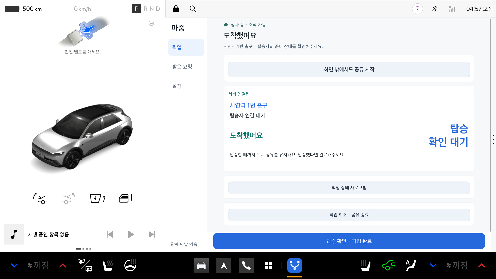

# 픽업 주요 버튼과 대기자 안내

도착 알리기·탑승 확인·다음 픽업 버튼을 오른쪽 화면 하단에 고정했다. QR이나 장소 제안처럼 긴 내용을 스크롤해도 현재 단계의 주요 버튼은 보인다. 픽업 취소는 상세 영역의 보조 동작으로 유지한다.

정차 상태에서만 조작할 수 있다. 기존 DrivingRestrictionMonitor와 버튼 제한을 그대로 사용하므로 주행 상태에서는 고정 버튼도 숨긴다.

‘받은 요청’ 메뉴는 수락 대기·픽업 대기 건수를 표시한다. 픽업 화면에는 다음 대기자의 이름·장소와 전체 대기자 수를 보여준다. 다음 사람은 운전자가 확인한 뒤 시작하며, 요약만으로 자동 시작하지 않는다. 탑승자 웹에는 다른 대기자의 이름·장소를 보내지 않는다.

## 확인

- 단위 시험·lintDebug·assembleDebug 통과
- 공식 Pleos 2.1 에뮬레이터의 `PickupActionDockTest` 1개 통과: 스크롤 전후 주요 버튼 위치, 전체 너비/높이 노출, ACTIVE→ARRIVED 때 버튼 전환 확인
- 시험용 상태와 로컬 비응답 API를 사용했다. 운영 픽업·초대는 만들지 않았다.
- release와 같은 키로 서명한 debug/시험 APK로 설치해 시험했다. 기존 앱 데이터를 삭제하지 않았다.
- 기존 VehicleReadabilityTest의 ActivityScenario 종료 대기 이슈 #116은 별개로 남아 있다. 이번 시험은 ActivityScenario의 DESTROYED 대기 대신 일반 Activity 종료로 정리한다.

