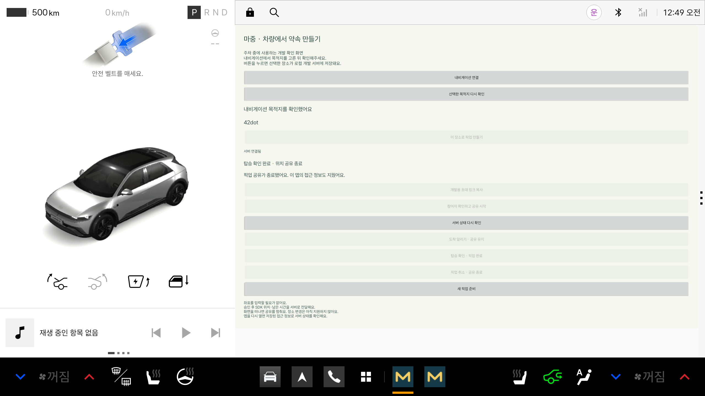

# 픽업 접근 정보 저장과 재실행 복구

기능: 9.2 토큰 저장·복구. 차량 등록 권한(9.1)과 화면 밖 전송(3.2)은 별도다.

## 저장하는 것

픽업 ID, 운전자 토큰, 아직 연결 전인 초대 토큰, 마지막 차량 정보 전송 순번만 저장한다.
위치·ETA·약속 장소·탑승자 이름은 저장하지 않는다. 약속 장소와 상태는 재실행 후 서버에서 다시 받는다.

`EncryptedPickupSessionStore`가 Android Keystore의 AES 키로 AES-GCM 암호화한다.
암호문은 `noBackupFilesDir/pickup-session.bin`에 AtomicFile로 교체 저장한다. 매번 새 IV를 사용한다.
파일 버전과 API origin을 인증 데이터에 묶어, 다른 서버 설정의 앱에서 기존 토큰을 복구하지 않는다.
저장 실패 때 평문으로 우회하지 않는다. 원문 토큰을 로그·toString·화면에 출력하지 않는다.

노션에서 예로 든 EncryptedSharedPreferences는 공식 API 문서에서 deprecated로 표시돼 있어 사용하지 않았다.
키 관리에는 Android Keystore를 쓰고, 작은 세션 하나만 암호화해 파일에 저장한다.
하드웨어 키 보호 지원 여부는 기기마다 다르다. 에뮬레이터 시험을 실차의 하드웨어 보호 검증으로 표현하지 않는다.

공식 근거: [Android Keystore](https://developer.android.com/privacy-and-security/keystore),
[EncryptedSharedPreferences API](https://developer.android.com/reference/androidx/security/crypto/EncryptedSharedPreferences).

## 복구 순서

1. Application이 암호문을 읽는다. 파일이 없으면 새 픽업을 준비할 수 있다.
2. 파일이 있으면 생성 버튼을 막고 `RESTORING` 상태에서 운전자 토큰으로 서버를 조회한다.
3. 성공하면 서버의 픽업 상태·장소·참여 상태를 표시한다. ACTIVE·ARRIVED 복구는 ‘이전 픽업 계속하기’를 누르기 전까지 전송하지 않는다. 선택 후 새 SDK 정보만 사용한다.
4. 네트워크 오류·서버 5xx는 저장을 유지한다. 화면의 3초 주기 조회 또는 ‘서버 상태 다시 확인’으로 재시도한다.
5. 완료·취소·만료 상태 또는 401/403/404/410이면 암호문과 메모리의 접근 정보를 지운다.
6. 변조·키 손실·지원하지 않는 파일 형식은 복원하지 않고 파일을 삭제한다.

삭제 실패 시 새 픽업 생성을 막는다. 새 픽업 준비 시에도 다시 삭제를 확인한다.
생성 후 저장 실패는 사용자에게 안내하고 현재 메모리의 픽업은 종료할 수 있게 유지한다.
파일 삭제는 파일시스템 수준 삭제이며 저장 장치의 물리적 덮어쓰기를 보장하지 않는다.

## 전송 순번

다음 순번을 네트워크 전송 **전**에 저장한다. 서버가 받았지만 앱이 응답을 받기 전에 종료돼도 같은 순번을 다시 보내지 않는다.
저장에 실패하면 그 차량 정보 요청은 전송하지 않는다. 복구한 순번에서 다음 번호로 이어 보낸다.
새 픽업을 만들 때는 기존처럼 별도의 순번을 사용한다.

## 코드 연결점

- `PickupSessionStore`: load/save/clear 경계. 컨트롤러 시험에서는 메모리 저장소를 사용할 수 있다.
- `EncryptedPickupSessionStore`: Keystore·암호화·파일 읽기/쓰기·삭제. 앱은 이 구현을 반드시 주입한다.
- `VehicleApplication`: 컨트롤러 생성 직후 restoreSession 호출.
- `PickupController`: 생성·초대 상태 변경·전송 전 저장, 서버 확인 후 복구, 종료/거절 시 삭제.
- `PickupStatusSection`: 서버 확인 중 상태 표시.

저장·삭제는 작은 파일에 동기적으로 수행한다. 원자적 교체와 전송 전 저장 순서를 우선한 초기 구현이다.
장시간 작업·큰 데이터를 여기에 추가하지 않는다. 이후 비동기 저장으로 바꾸면 순번 저장 완료 전 전송하지 않는 조건을 유지해야 한다.

## 확인한 범위

- 기존 단위 시험 8개·debug/시험 APK 빌드·lint 통과.
- 실제 Keystore 저장소를 쓰는 instrumentation 4개: 암호문 비평문·새 저장소에서 복원·변조 거절, 서버 확인·종료 삭제, 503 후 재시도, 401/403/404/410·잘린 파일 삭제.
- 두 프로세스 시험: prepare → force-stop → verify. 실제 로컬 API에서 ACTIVE 복구, 전송 순번 500→501, 도착·완료 후 삭제 확인.
- 이 두 프로세스 시험의 위치·ETA는 합성 fixture다. 실제 SDK 수신 검증과 구분한다.
- 기존 SDK 통합 시험 2개도 통과했다. 실제 SDK 위치·ETA·해제·재연결·준비·취소·도착·완료 흐름을 확인했다. 원본 결과는 Git 제외 evidence/private에 보관한다.

```sh
# 공식 에뮬레이터가 실행 중인 개발 환경
./gradlew :vehicle:testDebugUnitTest :vehicle:assembleDebug :vehicle:assembleDebugAndroidTest :vehicle:lintDebug
# APK 설치 후
adb shell am instrument --user 10 -w -e class app.majung.vehicle.PickupRecoveryTest \
  app.majung.vehicle.test/androidx.test.runner.AndroidJUnitRunner
# 두 프로세스 시험에는 Mac의 기본 로컬 API가 필요하다. 토큰은 명령 인자로 전달하지 않는다.
adb shell am instrument --user 10 -w -e class app.majung.vehicle.PickupProcessRecoveryTest -e recoveryPhase prepare \
  app.majung.vehicle.test/androidx.test.runner.AndroidJUnitRunner
adb shell am force-stop --user 10 app.majung.vehicle
adb shell am instrument --user 10 -w -e class app.majung.vehicle.PickupProcessRecoveryTest -e recoveryPhase verify \
  app.majung.vehicle.test/androidx.test.runner.AndroidJUnitRunner
```

사용자 강제 중지 후 앱을 열지 않아도 자동 실행되는 기능은 아니다. 화면 밖 지속 전송은 [별도 서비스 검증](background-sharing.md)을 확인한다. 재부팅 자동 시작·실차·실제 휴대전화는 검증 범위에 없다.
debug만 에뮬레이터 호스트(10.0.2.2)와 시험 fixture 루프백(127.0.0.1)의 HTTP를 허용한다. release 설정은 바꾸지 않았다.

완료 후 접근 정보 삭제 안내와 재실행 복구 문구를 확인한 에뮬레이터 화면이다.


