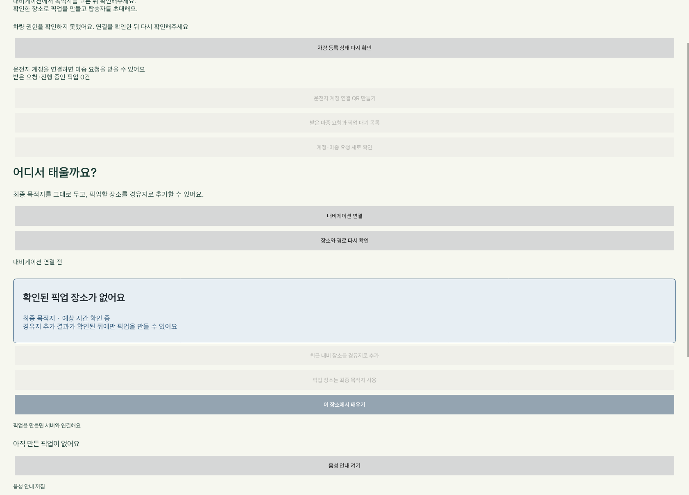

# 준비 완료·도착 음성 안내

차량에서 ‘음성 안내 켜기’를 누르면 탑승자가 준비를 마쳤을 때와 픽업 장소에 도착했을 때 안내한다.
처음에는 꺼져 있으며, 선택은 차량에 저장한다. 켜고 끄는 조작에는 기존 주행 제한을 적용한다.

- 준비 완료: “탑승자가 준비를 마쳤어요.”
- 도착: “약속 장소에 도착했어요. 안전하게 정차한 뒤 탑승을 확인해주세요.”

사람 이름·마중 ID·장소 이름은 읽지 않는다. Pleos TextToSpeech 3.3.1의 `ON_DEVICE` 모드를 사용하며 클라우드 키를 요구하지 않는다.

## 반복·오래된 안내 방지

`PickupVoicePolicy`가 이번 프로세스에서 확인한 상태 변화만 고른다. 같은 상태의 주기 조회와 준비 상태 반복 전환은 같은 픽업에서 다시 읽지 않는다.
앱 복구·재연결·음성 켜기만으로 이전 준비 완료나 도착을 다시 읽지 않는다. 공유 재개 확인 전과 연결이 끊긴 동안의 변경도 나중에 재생하지 않는다.
`PickupVoiceGuide`는 앱에 속한 픽업 관찰자이므로 기존 공유 서비스가 상태를 읽는 동안 화면 밖에서도 변화를 확인한다. 앱 강제 종료 후 자동 음성 재생은 하지 않는다.

공유 종료·통신 끊김·설정 끄기에는 재생을 중단한다. 오디오 포커스를 얻지 못하면 화면 안내만 사용하고, 통화 등으로 포커스를 잃으면 멈춘다.
SDK 초기화·재생·중지 응답에 제한 시간을 둔다. 음성 엔진 오류로 픽업 처리를 막지는 않는다.

## 확인한 범위

- 차량 JVM 테스트 39개 통과. 상태 변화·복구·억제·중복 안내 정책 포함.
- 계측 테스트 4개 통과. 가상 서버의 준비·도착·503·복구·종료와 설정 저장 확인.
- Pleos 에뮬레이터에서 실제 ON_DEVICE 초기화·재생 시작·재생 완료 콜백 확인.
- 증거: `docs/evidence/voice-sdk-2026-10-26.json`.

에뮬레이터는 호스트 오디오 출력을 끈 상태였다. 실제 스피커로 들리는 음량·음질, 전화 통화와의 우선순위, 실차 동작은 확인하지 않았다.

공식 문서: [SDK 소개](https://document.pleos.ai/en/api-reference/connect-sdk-pleos/TextToSpeech/intro), [초기화·해제](https://document.pleos.ai/en/docs/pleos-only/connect-sdk-pleos/TextToSpeech/initialization-and-release), [이벤트](https://document.pleos.ai/en/docs/pleos-only/connect-sdk-pleos/TextToSpeech/event-listeners).
