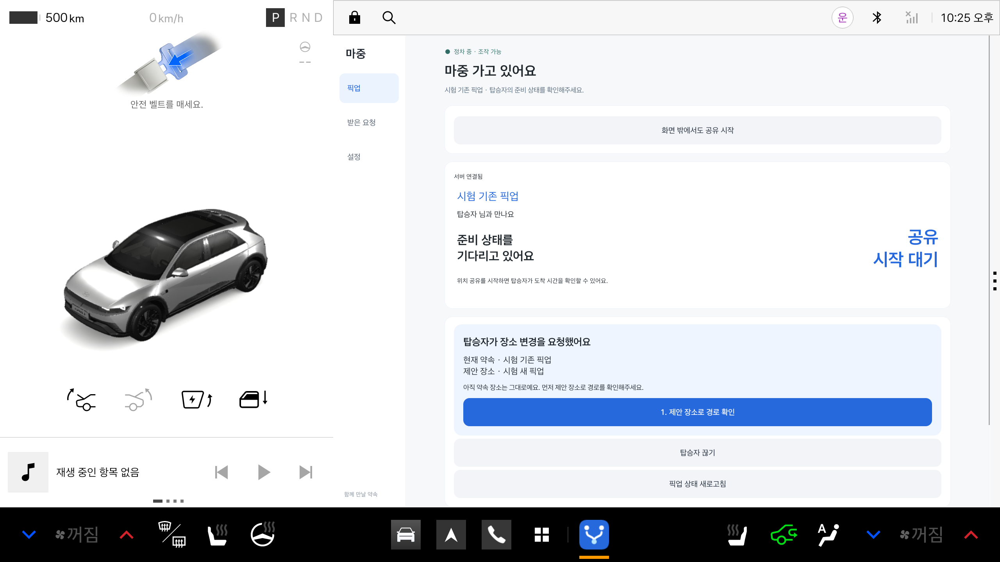

# 탑승자가 제안한 장소 확인

탑승자가 장소를 제안하면 차량의 픽업 화면에 ‘탑승자가 장소 변경을 요청했어요’ 카드가 나타난다. 현재 약속 장소와 제안 장소를 함께 표시한다. 제안을 받았다는 이유만으로 내비 경로나 약속 장소를 바꾸지는 않는다.

1. 정차한 상태에서 ‘제안 장소로 경로 확인’을 누른다.
2. 기존 최종 목적지와 다른 경유지를 유지하면서 제안 장소의 경로를 확인한다.
3. 경로와 해당 장소의 예상 시간이 확인되면 ‘새 장소 확정’이 나타난다.
4. 확정 후 탑승자의 약속 장소도 바뀐다.

서버 연결이 끊겨도 받은 제안 카드는 남고 연결 확인 안내를 표시한다. 연결이 복구되기 전에는 경로 확인·확정을 실행할 수 없다. 제안이 취소되거나 픽업이 끝나면 카드를 숨긴다.

## 확인 결과

2026년 10월 29일 단위 테스트·디버그 빌드·Android lint가 통과했다. 별도 Pleos 에뮬레이터에서 화면 상태 시험을 실행해 다음을 확인했다.

- 현재 장소·제안 장소를 함께 표시
- 경로 검증 전 확정 버튼 숨김 및 실행 차단
- 연결이 끊겨도 제안 안내 유지, 확인 버튼 비활성화
- 제안 취소 시 카드 숨김

화면 상태 시험은 가상 데이터를 사용했다. 실제 휴대전화에서 제안하고 공식 SDK 경로 변경을 거쳐 확정하는 전체 시험 결과와 구분한다.

## SDK와 로컬 서버 연동 재확인

같은 날 `PlaceConfirmationSdkTest`가 70.82초에 통과했다. 공식 Pleos 에뮬레이터와 로컬 메모리 DB 서버를 사용했으며 실제 운영 계정·차량은 변경하지 않았다.

- 기존 최종 목적지와 다른 경유지 유지
- 이전 픽업 경유지를 제안 장소로 교체
- SDK 연결을 새로 만든 뒤에도 경로·예상 시간 재검증
- 서버 장소 버전 2 확정 및 탑승자 조회 확인
- 새 장소 버전에 해당하는 차량 정보 전달

[결과 항목](evidence/place-proposal-sdk-2026-10-29.json)을 남겼다. 이어서 첫 사용 안내를 거친 `PlaceProposalScreenTest`도 1.425초에 통과했다. 아래 화면은 가상 픽업·가상 장소를 사용하는 화면 시험이다. 실제 휴대전화·실차 결과가 아니다.

