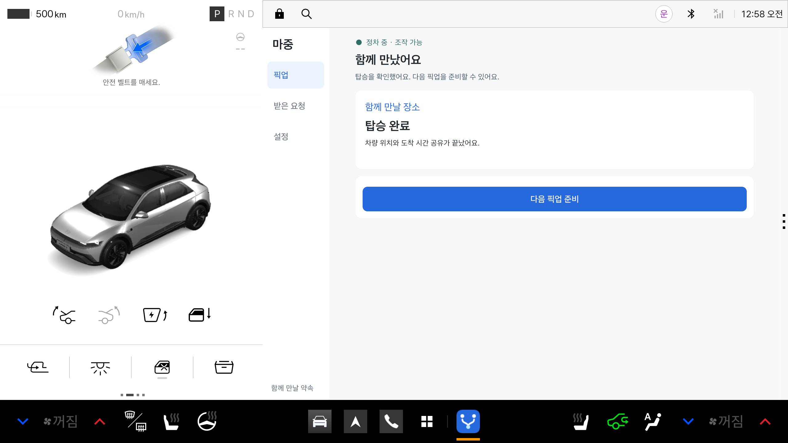
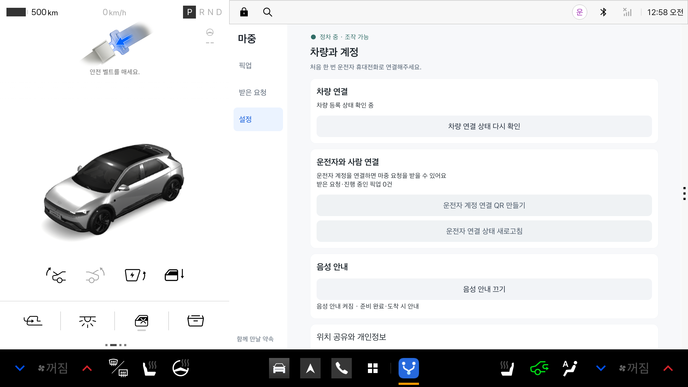
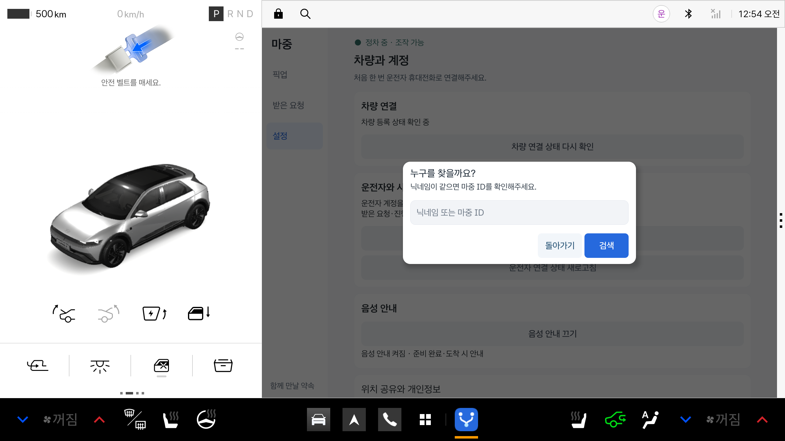

# 차량 화면 글자와 버튼 크기

기존 안내 문구는 14~18sp, 버튼은 20sp였다. 차량 화면에서 떨어져 보면 작아 본문·버튼·대화상자의 크기를 함께 조정했다.

| 용도 | 변경 기준 |
| --- | --- |
| 보조 설명·상태 안내 | 최소 24sp |
| 본문·버튼·검색 입력·사람 목록 | 28sp |
| 카드 제목·검색창 제목 | 32sp |
| 화면 제목·주요 상태 | 40sp |
| 픽업 도착 시간 | 56sp |
| 주행 요약 | 상태 40sp·준비 32sp·시간 64sp |
| 공통 버튼 | 최소 높이 80dp·버튼 사이 16dp |

시스템 글자 확대 설정을 그대로 따른다. 큰 글씨가 들어갈 수 있게 사이드 메뉴 폭과 버튼 높이·여백도 늘렸다. 비활성 버튼은 조작 가능 여부를 유지하면서 글자 대비를 높였다. 정차 중 상세 화면과 주행 중 읽기 전용 요약은 계속 구분한다.

완료 화면은 탑승자 연결 대기와 이전 안내를 숨기고, 위치 공유 종료와 다음 픽업 준비를 보여준다. 지난 픽업에서 누른 ‘다음 픽업’의 피드백이 새 픽업 완료 화면까지 남지 않도록 초기화했다.

## 확인 범위

- 공식 Pleos 2.1 에뮬레이터, 2560×1440·160dpi
- 기본 글꼴과 130% 확대에서 완료·설정·검색 화면 확인
- 자동 검사에서 보이는 본문의 크기, 버튼 높이·글자 잘림, 완료 후 대기 문구 제거 확인
- 장소 제안 카드와 주행 요약 제한 검사는 기존 검사로 확인
- 아래 화면은 서버 요청을 보내지 않는 시험용 상태다. 실제 사용자 정보나 초대 링크는 포함하지 않는다.
- 고령 사용자 대상 사용성 조사·실차 가독성 평가를 마쳤다는 뜻은 아니다.

[Android Automotive 글자 가이드](https://developers.google.com/cars/design/automotive-os/design-system/typography)의 본문 크기와 정보 위계를 참고했다. Pleos의 심사 통과 여부와는 별개다.

### 완료 화면 · 기본 글꼴

### 설정 · 기본 글꼴

### 사람 검색 · 130% 확대

