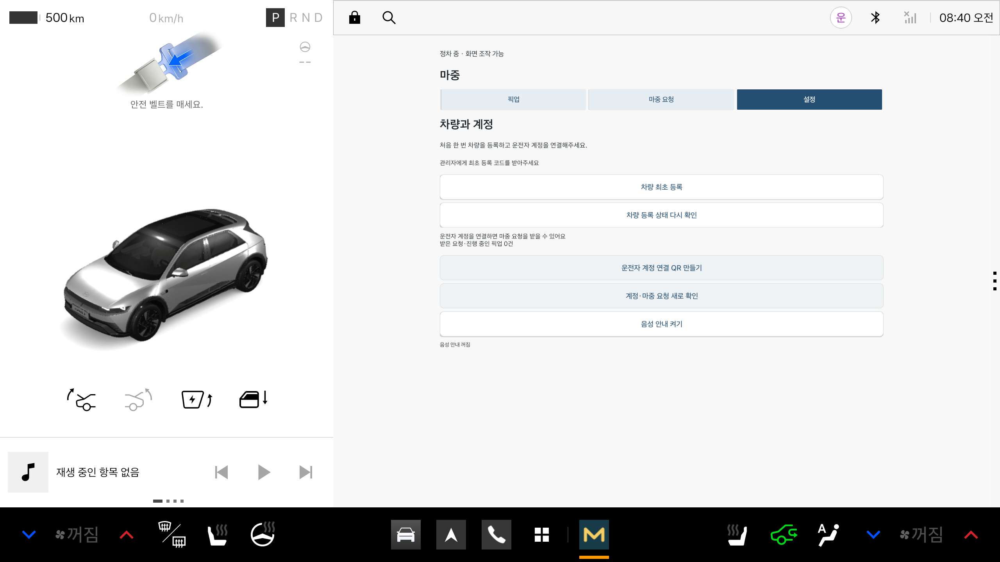

# Release APK 빌드 및 서명

마중 차량 앱의 배포용 APK를 빌드하고 서명을 검증하는 절차를 정리한 문서다.

팀 테스트 및 제출용 Release APK는 마중 운영 HTTPS 서버와 전용 서명 키를 사용해 빌드한다.

서명에 필요한 비밀번호와 키 파일은 저장소 외부에서 관리하며, 빌드 결과에는 소스 커밋 정보를 기록한다.

## 1. 현재 배포 버전

**기준일: 2026년 10월 29일**

| 항목 | 내용 |
| --- | --- |
| 버전 | `0.2.14-preview` |
| versionCode | `16` |
| 배포 형식 | 서명된 Release APK |
| 운영 API | `https://majung.cloud` |
| 배포 위치 | GitHub Releases |

**[v0.2.14-preview APK 받기](https://github.com/majung-team/majung-vehicle-app/releases/tag/v0.2.14-preview.20261029)**

이 문서의 빌드 절차는 직접 APK를 만드는 개발자를 대상으로 한다.

일반적인 에뮬레이터 설치 시험에서는 Releases에 게시된 서명 APK를 사용할 수 있다.

---

## 2. 빌드 전 준비

다음 환경이 필요하다.

- JDK 25
- Android SDK API 34
- Gradle 빌드 환경
- Python 3
- Release 서명용 Keystore
- 저장소 외부의 서명 설정 파일

빌드 전에 현재 소스 변경 사항을 확인한다.

```sh
git status
git rev-parse HEAD
```

`tools/build-release.py`는 미커밋 변경 또는 미추적 파일이 남아 있으면 빌드를 중단한다.

배포 APK의 소스 버전을 명확히 추적하기 위한 조건이다.

---

## 3. 서명 설정

### 설정 파일 위치

기본 설정 경로:

```text
~/.local/share/majung-signing/release-signing.json
```

다른 위치의 설정 파일은 `--config` 옵션으로 지정할 수 있다.

### 설정 파일 형식

```json
{
  "storeFile": "/저장소밖/majung-release.jks",
  "storePassword": "개인적으로 보관한 값",
  "keyAlias": "majung-release",
  "keyPassword": "개인적으로 보관한 값"
}
```

위 값은 형식 예시이며, 실제 서명 정보가 아니다.

### 파일 접근 권한

서명 설정 파일과 Keystore 파일은 현재 사용자가 소유해야 하며, 소유자만 접근할 수 있도록 권한을 설정한다.

```sh
chmod 600 ~/.local/share/majung-signing/release-signing.json
chmod 600 /저장소밖/majung-release.jks
```

빌드 스크립트는 파일 소유자와 권한을 검사한다.

설정 파일이나 Keystore가 없거나 접근 권한 조건에 맞지 않으면 빌드를 중단한다.

### 서명 정보 관리

다음 정보는 Git 저장소에 추가하지 않는다.

- Keystore 원본 파일
- 서명 비밀번호
- 개인 키
- 실제 값이 포함된 JSON 설정 파일

서명 비밀번호는 명령줄 인자로 직접 전달하거나 빌드 로그에 출력하지 않는다.

빌드 스크립트는 설정 파일을 읽고 필요한 값을 Gradle 프로세스의 환경변수로 전달한다.

---

## 4. Release APK 빌드

### 기본 빌드

프로젝트 루트에서 실행한다.

```sh
python3 tools/build-release.py
```

### 다른 설정 파일 사용

```sh
python3 tools/build-release.py \
  --config /path/to/release-signing.json
```

### 빌드 스크립트 동작

`tools/build-release.py`는 다음 순서로 실행한다.

1. 서명 설정 파일 존재 여부 확인
2. 설정 파일 및 Keystore의 소유자·권한 검사
3. 필수 서명 정보 확인
4. Git 작업 트리의 변경 사항 검사
5. 현재 `HEAD` 커밋 SHA 확인
6. 운영 HTTPS API 주소 지정
7. Gradle Release 빌드 실행
8. 생성된 APK 경로 및 소스 커밋 출력

실제 Gradle 작업에는 다음 설정이 적용된다.

```sh
./gradlew :vehicle:assembleRelease \
  -PpickupApi=https://majung.cloud \
  --no-configuration-cache \
  --no-daemon
```

서명 정보와 `MAJUNG_BUILD_SHA`는 빌드 스크립트가 환경변수로 설정한다.

### Release 빌드 조건

Release 패키징은 다음 조건을 만족해야 한다.

- HTTPS API origin 명시
- 서명 설정 및 Keystore 파일 준비
- 소스 커밋 SHA 확인
- 필요한 서명 환경변수 설정

조건을 만족하지 않으면 Release 패키징을 중단한다.

---

## 5. 빌드 결과

생성되는 APK 경로:

```text
vehicle/build/outputs/apk/release/vehicle-release.apk
```

빌드가 끝나면 출력된 소스 커밋과 APK 경로를 확인한다.

Release APK에는 빌드 기준 소스 커밋을 식별할 수 있도록 `MAJUNG_BUILD_SHA`가 적용된다.

배포 파일명은 Releases 게시 과정에서 별도로 지정할 수 있다.

---

## 6. APK 서명 및 배포 전 검증

APK를 다른 개발자나 테스트 참가자에게 전달하기 전에 서명과 빌드 정보를 확인한다.

### 서명 검증

Android SDK의 `apksigner`를 사용한다.

```sh
apksigner verify --verbose --print-certs \
  vehicle/build/outputs/apk/release/vehicle-release.apk
```

검증할 항목:

- APK 서명 검증 성공
- 예상한 인증서 정보
- 기존 배포 APK와의 서명 일치 여부
- Android 버전에 적합한 서명 방식

### 빌드 정보 확인

배포 전에 다음 사항을 확인한다.

- APK 버전 및 versionCode
- 빌드 기준 Git 커밋
- 운영 HTTPS API 주소
- Release 빌드 여부
- Debug 전용 설정 또는 권한 포함 여부

서명이 정상이라는 사실만으로 운영 서버 주소나 모든 빌드 설정이 올바르다고 판단하지 않는다.

### APK 무결성 기록

배포 파일의 SHA-256을 함께 기록하면 이후 전달받은 파일과 비교할 수 있다.

```sh
shasum -a 256 \
  vehicle/build/outputs/apk/release/vehicle-release.apk
```

배포 시 버전, 소스 커밋, 파일 해시를 함께 관리한다.

---

## 7. 기존 APK 업데이트 시 주의사항

Release APK는 일반적인 Debug APK와 서명이 다르다.

따라서 기존 Debug 앱 위에 Release APK를 덮어 설치하면 서명 불일치로 실패할 수 있다.

### 서명 불일치가 발생한 경우

`adb install -r`이 실패했다고 해서 기존 앱을 즉시 삭제하지 않는다.

먼저 다음 사항을 확인한다.

1. 진행 중인 픽업 여부
2. 차량 접근 권한 및 계정 연결 상태
3. 기존 APK의 서명과 버전
4. 새 APK의 서명 정보
5. 차량 재등록 필요 여부

앱을 삭제하면 로컬에 저장된 차량 및 픽업 접근 정보도 제거된다.

재설치 후 최초 차량 연결이 필요할 수 있으므로, 테스트 환경과 실제 사용 중인 환경을 구분해 진행한다.

---

## 8. 서명 키 백업 및 관리

Release 서명 키는 동일한 앱을 기존 설치본 위에 업데이트하는 데 필요한 중요한 자산이다.

기존 서명 키를 잃으면 동일한 서명으로 새 APK를 만들 수 없다.

### 관리 원칙

- 서명 키와 설정 파일은 저장소 외부에 보관
- 접근 가능한 사용자 최소화
- 안전한 별도 위치에 백업
- 비밀번호와 Keystore 관리 경로 분리
- 팀 공용 문서나 공개 저장소에 업로드 금지
- APK 파일과 함께 개인 키 전달 금지

APK 자체에는 서명용 개인 키가 포함되지 않는다.

서명 키를 새로 생성할 경우 기존 APK의 업데이트 호환성에 영향을 줄 수 있으므로 별도 배포 계획이 필요하다.

---

## 9. 초기 Release 설치 시험

**기록일: 2026년 10월 27일**

초기 Release APK의 설치 가능 여부를 확인한 기록이다.

### 시험 버전

**[v0.2.0-preview](https://github.com/majung-team/majung-vehicle-app/releases/tag/v0.2.0-preview.20261027)**

| 항목 | 결과 |
| --- | --- |
| 버전 | `0.2.0-preview` |
| versionCode | `2` |
| 소스 커밋 | `72c5c3e` |
| 시험 환경 | 새 Pleos 공식 AVD |
| APK v2 서명 | 확인 |
| Debug 비활성화 | 확인 |
| 평문 HTTP 비활성화 | 확인 |
| 최초 설정 화면 실행 | 확인 |

### 시험 과정

1. 별도의 새 Pleos AVD 준비
2. 초기 Release APK 설치
3. 차량 앱 실행
4. 최초 설정 화면 표시 확인
5. APK 서명 및 빌드 설정 확인

기존 개발용 에뮬레이터의 앱이나 등록 정보는 변경하지 않았다.

이 시험에서는 운영 차량 등록을 진행하지 않았고, 실제 차량도 사용하지 않았다.

### 시험 화면



위 이미지는 `0.2.0-preview` 당시의 설치 시험 기록이다.

현재 게시된 `0.2.14-preview`의 전체 기능 검증 결과를 나타내는 화면은 아니다.

---

## 10. 검증 범위

### 이 문서에서 다루는 내용

- Release APK 빌드
- HTTPS API 설정
- 전용 서명 키 사용
- Git 커밋 추적
- APK 서명 확인
- 초기 Release 설치 시험
- APK 업데이트 시 주의사항

### 별도 확인이 필요한 내용

- 실제 차량 설치 및 실행
- 장시간 위치·ETA 공유
- 차량 시동 OFF/ON 후 복구
- 실제 휴대전화와의 전체 픽업 흐름
- 앱마켓 등록 및 심사 승인

Release APK를 생성하고 공식 에뮬레이터에 설치할 수 있다는 사실이 실제 차량에서의 사용이나 상용 배포 승인을 의미하지는 않는다.

---

## 11. 관련 문서

- [차량 앱 README](../README.md)
- [차량 최초 연결](vehicle-enrollment.md)
- [픽업 접근 정보 저장 및 복구](pickup-recovery.md)
- [백그라운드 위치·ETA 공유](background-sharing.md)
- [팀 테스트 안내](https://github.com/majung-team/majung/blob/main/docs/team-testing.md)
- [개발 현황 및 PR 근거](https://github.com/majung-team/majung/blob/main/docs/development-status.md)
- [차량 앱 Releases](https://github.com/majung-team/majung-vehicle-app/releases)

---

## 문서 관리 기준

이 문서는 마중 차량 앱의 Release 빌드 및 서명 절차를 설명한다.

배포 버전이 변경되면 새로운 Release 링크, versionCode, 빌드 커밋 및 APK 해시를 기록한다.

기존 설치 시험 결과는 당시 버전의 기록으로 유지하며, 새 버전의 검증 결과로 대체하지 않는다.

서명 정보 및 개인 키는 문서와 저장소에 포함하지 않는다.
