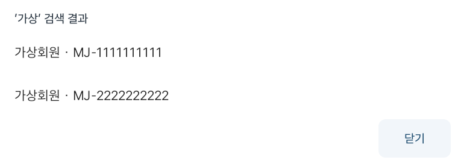

# 받은 요청에서 픽업 시작하기

탑승자가 모바일 웹에서 보낸 픽업 요청을 차량에서 확인하고, 내비게이션 경로를 준비한 뒤 픽업을 시작하는 과정을 정리한 문서다.

마중은 요청 수락과 실제 픽업 시작을 구분한다. 여러 요청을 받아도 진행 중인 픽업은 한 건만 유지하며, 각 요청은 자신의 차례에 경로를 확인한 후 시작한다.

---

## 1. 운전자 이용 순서

### 요청 확인 및 수락

1. 차량 앱의 **받은 요청**에서 탑승자와 픽업 장소 확인
2. 새로운 요청은 **수락하고 마중 준비** 선택
3. 이미 수락한 대기 요청은 **마중 가기** 선택
4. 내비게이션 경로 준비 및 장소 확인
5. 검증 완료 후 **마중 시작 · 위치 공유** 선택
6. 도착 후 탑승 확인 및 픽업 완료
7. **다음 대기자 확인**에서 다음 요청 선택

다른 픽업이 진행 중이라면 새 요청은 대기열에 추가한다. 현재 픽업이 종료되기 전에는 다음 요청을 시작하지 않는다.

### 위치 공유 시작

경로 확인이 끝나도 위치 공유가 자동으로 시작되지는 않는다.

운전자가 **마중 시작 · 위치 공유**를 선택해야 하며, 최초 이용 시 위치 권한 허용이 필요할 수 있다.

픽업이 시작되면 차량 SDK에서 전달된 유효한 위치와 예상 도착 시간을 해당 탑승자에게 공유한다.

---

## 2. 내비게이션 경로 준비

마중은 요청받은 픽업 장소가 현재 내비게이션 경로에 포함되어 있는지 확인한다.

### 요청 장소가 이미 경로에 있는 경우

현재 경로에서 같은 장소가 확인되면 추가 경유지를 만들지 않고 기존 경로를 사용한다.

### 요청 장소가 경로에 없는 경우

1. 현재 최종 목적지와 경유지 조회
2. 요청받은 픽업 장소 확인
3. 기존 최종 목적지와 경유지를 유지하면서 새 경유지 추가
4. SDK에서 변경된 경로 재조회
5. 요청 장소와 경로가 일치하는지 확인
6. 검증 완료 후 픽업 시작 허용

경유지 추가 요청만 성공했다고 해서 실제 경로 준비가 끝난 것으로 판단하지 않는다.

### 경유지가 이미 두 곳인 경우

기존 경유지가 두 곳이라면 차량 내비게이션에서 경로를 먼저 정리해야 한다.

마중이 기존 경유지를 임의로 삭제하거나 덮어쓰지 않는다.

### 경로 준비 취소

운전자가 경로 준비를 취소하더라도 다음 작업은 자동으로 수행하지 않는다.

- 탑승자의 픽업 요청 취소
- 이미 추가한 경유지 삭제
- 기존 내비게이션 경로로 자동 복원

경로 준비 도중 운전자가 직접 내비게이션을 변경했을 수 있으므로, 자동 복구 과정에서 사용자의 경로를 덮어쓰지 않도록 한다.

---

## 3. 요청 준비와 시작 조건

픽업 시작 전에는 요청 상태, 운전자 권한, 대기열, 내비게이션 경로를 확인한다.

### 시작 허용 조건

- 요청이 유효한 상태
- 해당 차량의 운전자 계정과 요청 대상 일치
- 다른 픽업이 진행 중이지 않은 상태
- 최신 요청 목록 확인
- SDK 연결 및 경로 준비 완료
- 요청 장소와 실제 경로 일치
- 운전자의 명시적인 픽업 시작 확인

### 시작을 차단하는 조건

- 요청 취소 또는 만료
- 운전자 계정 변경
- 다른 픽업이 이미 진행 중인 경우
- 픽업 장소 또는 경로 변경
- SDK 연결 실패
- 경로 검증 실패
- 요청 준비 시간 초과
- 최신 요청 상태 확인 실패

조건이 충족되지 않으면 픽업을 강제로 시작하지 않고 해당 오류나 대기 상태를 표시한다.

---

## 4. SDK 연결 및 시간 제한

내비게이션 SDK는 연결과 경로 응답이 비동기로 처리될 수 있으므로 각 단계에 시간 제한을 둔다.

| 항목 | 기준 | 처리 |
| --- | --- | --- |
| 내비게이션 초기 연결 | 12초 | 성공·실패 응답이 모두 없으면 연결 오류 표시 |
| 전체 경로 준비 | 최대 60초 | 준비가 끝나지 않으면 시간 초과 처리 |
| 서버 요청 목록 | 마지막 확인 후 15초 | 오래된 목록이면 최신 상태 재조회 |
| 픽업 시작 응답 유실 | 즉시 자동 재전송하지 않음 | 서버 결과 확인 안내 |

위 값은 이 기능에 적용한 구현 기준이다.

### 초기 연결 응답 누락

SDK 연결에 성공 또는 실패 응답이 모두 없는 경우 12초 후 연결 오류를 표시한다.

사용자는 연결을 다시 시도할 수 있다.

재연결할 때는 연결 세대 번호를 갱신하여 이전 연결에서 늦게 전달된 응답을 현재 결과로 사용하지 않도록 처리한다.

과거 에뮬레이터 재시작으로 연결이 복구된 사례가 있으나, SDK 내부 원인까지 확인된 것은 아니다.

### 전체 경로 준비

요청 장소를 확인하고 내비게이션 경로를 검증하는 과정은 최대 60초까지 기다린다.

제한 시간이 지나면 준비 작업을 종료하고 오류 상태를 표시한다.

기존 요청을 임의로 취소하거나 픽업을 강제로 시작하지 않는다.

---

## 5. 중복 요청 및 상태 불일치 방지

### 중복 경유지 추가 방지

동일한 요청의 경로 준비 과정에서 경유지를 반복해서 추가하지 않도록 처리한다.

화면 새로고침이나 요청 목록 재조회는 기존 경유지 추가 명령을 다시 실행하지 않는다.

### 중복 픽업 시작 방지

픽업 시작 요청을 보낸 후 응답을 받지 못한 경우 같은 요청을 자동 재전송하지 않는다.

먼저 서버에서 현재 픽업 상태를 확인한다.

동일 요청의 중복 시작은 서버의 기존 중복 방지 처리와 함께 관리한다.

### 요청 목록 최신성

마지막으로 서버 요청 목록을 확인한 지 15초가 넘었다면 최신 목록을 다시 조회한다.

다른 활성 픽업이 존재하는지는 차량 앱의 로컬 상태뿐 아니라 서버 응답도 확인한다.

이를 통해 오래된 화면을 기준으로 다음 픽업을 시작하는 상황을 방지한다.

### 상태 변경 중 화면 조작

요청 준비 중 탑승자가 장소를 바꾸거나 요청이 취소·만료되면 이전 상태를 기준으로 픽업을 시작하지 않는다.

운전자 계정이 변경된 경우에도 기존 준비 결과를 사용하지 않는다.

---

## 6. 앱 재실행 및 연결 복구

차량 앱을 다시 실행했을 때 진행 중인 픽업과 경로 준비 중이던 작업은 다르게 처리한다.

### 진행 중인 픽업

진행 중이던 픽업은 암호화된 세션 정보를 통해 복구한다.

1. 차량 앱 재실행
2. 저장된 픽업 접근 정보 확인
3. 서버에서 현재 상태와 접근 권한 조회
4. 운전자에게 계속하기 또는 취소 선택 제공
5. 계속하기 확인 후 SDK 재연결
6. 새로운 위치·ETA 수신 후 공유 재개

운전자의 확인 없이 위치 공유를 자동 재개하지 않는다.

### 경로 준비 중이던 요청

경로 준비 작업은 별도 디스크 저장 대상으로 관리하지 않는다.

앱이 재실행되면 이전 경로 준비를 자동으로 이어가지 않고 요청 목록에서 해당 요청을 다시 선택하도록 한다.

### 통신 및 종료 처리

연결이 끊긴 경우 오래된 ETA를 계속 현재 정보처럼 표시하지 않는다.

픽업이 완료되거나 취소·만료된 경우에는 기존 종료 처리에 따라 위치 공유와 접근 권한을 차단한다.

---

## 7. 화면 및 사용자 조작

### 사람 연결 목록이 비어 있을 때

초대 창에 연결된 사람이 없다면 다음 메뉴로 바로 이동할 수 있다.

- **사람 찾기**
- **QR로 초대**

별도로 설정 메뉴를 여러 번 이동하지 않고 필요한 연결 기능을 사용할 수 있도록 구성했다.

### 검색 및 확인 창

검색·확인 창은 콘텐츠 폭을 제한하고 글자와 터치 영역을 확보했다.

해당 이미지는 공식 에뮬레이터 앱 화면에 시험용 계정을 적용한 결과다.

실제 회원 정보를 사용한 화면이 아니다.

### 화면 전환 효과

| 항목 | 동작 |
| --- | --- |
| 메뉴 전환 | 약 0.18초 |
| 확인 창 표시 | 약 0.18초 |
| 위치·ETA 갱신 | 전환 효과 없음 |
| 시스템 애니메이션 비활성화 | 효과 생략 |
| 주행 제한 적용 | 진행 중인 화면 효과 중단 |

위치와 ETA 같은 실시간 정보에는 불필요한 전환 효과를 적용하지 않는다.

주행 제한이 적용되면 상세 조작을 제한하고 화면 전환 효과도 중단한다.

---

## 8. 화면 여백 및 배치 기준

검색 및 확인 창의 가독성과 조작성을 고려해 여백을 조정했다.

| 영역 | 기준 |
| --- | --- |
| 설명 본문 아래 | 16dp |
| 버튼 위 | 12dp |
| 버튼 사이 | 8dp |
| QR 이미지 영역 | 최대 320dp |

목록의 내부 여백은 픽셀이 아닌 Android의 dp 단위로 계산한다.

QR 이미지 크기를 제한해 본문과 하단 조작 버튼이 불필요하게 멀어지지 않도록 했다.

화면 폭이 달라지더라도 텍스트와 조작 영역이 과도하게 벌어지지 않도록 구성한다.

---

## 9. 코드 구성

### 주요 클래스

| 클래스 | 역할 |
| --- | --- |
| `RequestPickupFlow` | 요청 경로 준비, 검증, 시작 상태 및 시간 제한 |
| `VehicleApplication` | 계정·내비게이션·픽업 컨트롤러 연결 |
| `RequestPickupSection` | 경로 준비, 오류 표시 및 시작 확인 화면 |

`RequestPickupFlow`는 경로 준비 상태를 관리하지만 요청이나 준비 중 경로 정보를 디스크에 별도로 저장하지 않는다.

실제 진행 중인 픽업의 복구는 기존 암호화 세션 저장 구조를 사용한다.

---

## 10. 테스트 및 검증 결과

### 단위 테스트

다음 상황에 대한 검사를 구성했다.

- 중복 경유지 추가 방지
- 중복 픽업 시작 방지
- 경로 변경 및 장소 불일치
- 오래된 요청 목록
- 취소 및 만료된 요청
- 다른 운전자 계정
- 이미 진행 중인 픽업
- 다음 대기자 처리
- 서버 시작 응답 유실

### 에뮬레이터 테스트

- 초기 SDK 연결 응답 누락
- 계정 및 초대 관련 동작
- 차량 최초 연결
- 저장된 픽업 세션 복구
- 통신 실패 및 재연결
- 종료 후 저장 정보 삭제
- 주행 제한 시 요약 화면

### 실제 SDK 시험

Pleos 공식 에뮬레이터에서 실제 SDK를 사용하여 다음 항목을 확인했다.

- 내비게이션 경로 수신
- 픽업 요청 장소의 경로 준비
- 명시적 픽업 시작 확인

시험에 사용한 시작 API는 개발용이며, 실제 탑승자의 픽업을 생성하지 않는다.

### 안내 취소 재시험 기록

**내비게이션 취소 후 안내 상태 유지**

실제 SDK 시험에서 `cancelRoute` 호출 이후에도 `ROUTE_GUIDING` 상태가 유지되어 취소 확인 검사가 실패했다.

SDK 설정에 사용한 연결과 현재 상태 조회 연결에서 동일한 현상이 관찰됐다.

[차량 이슈 #56](https://github.com/majung-team/majung-vehicle-app/issues/56)

과거 실패 기록은 그대로 유지한다. 10/31 복제 AVD에서 SDK 직접 취소 2회와 `RouteRecoveryTest`를 재실행해 모두 통과했다. 백그라운드 경로 변경, 취소 후 위치 숨김 12초, 새 안내·재연결 후 공유 복구까지 확인했다. [재시험 근거](../evidence/2026-10-31-sdk-cancel/README.md)를 추가했고 이슈 #56을 종료했다. 과거 원인은 미확정이며 재발하면 다시 확인한다.

마중의 픽업 완료·취소는 서버 위치 공유를 종료하며, 내비게이션 안내를 취소하지 않으므로 `cancelRoute`를 호출하지 않는다.

SDK 취소 동작의 문제와 픽업 공유 종료 기능은 구분하여 관리한다.

---

## 11. 추가 검증 범위

현재 확인한 로컬·에뮬레이터 시험과 실제 사용자 환경에서의 검증은 구분한다.

추가로 확인할 항목은 다음과 같다.

- 실제 휴대전화에서 새로운 픽업 요청
- 실제 운전자·탑승자 계정 간 요청 수락
- 실제 휴대전화와 차량 앱의 전체 픽업 흐름
- 실제 차량 내비게이션의 경로 및 경유지 변경
- 네트워크 전환과 장시간 실행
- 실제 차량의 주행 제한 및 위치 공유

이 문서에서 설명하는 기능의 코드 반영과 테스트 결과가 실제 차량 배포 가능성을 의미하지는 않는다.

---

## 12. 관련 문서

- [차량 앱 README](../README.md)
- [차량 화면 구성](service-screens.md)
- [차량 최초 연결](vehicle-enrollment.md)
- [차량 계정 및 요청](vehicle-account-requests.md)
- [픽업 저장 및 복구](pickup-recovery.md)
- [백그라운드 공유](background-sharing.md)
- [SDK 콜백 및 경로 시험](sdk-callback-timing.md)
- [전체 시스템 아키텍처](https://github.com/majung-team/majung/blob/main/docs/architecture.md)
- [개발 현황과 PR 근거](https://github.com/majung-team/majung/blob/main/docs/development-status.md)

---

## 문서 관리 기준

이 문서는 요청을 수락한 후 경로를 준비하고 실제 픽업을 시작하는 과정에 집중한다.

UI 개선 이력이나 SDK 내부 진단 결과는 관련 문서 및 GitHub 이슈와 연결하여 관리한다.

실제 SDK 경로 확인, 개발용 시작 API 시험, 실제 휴대전화 통합 시험 및 실차 검증은 서로 다른 범위로 구분한다.
