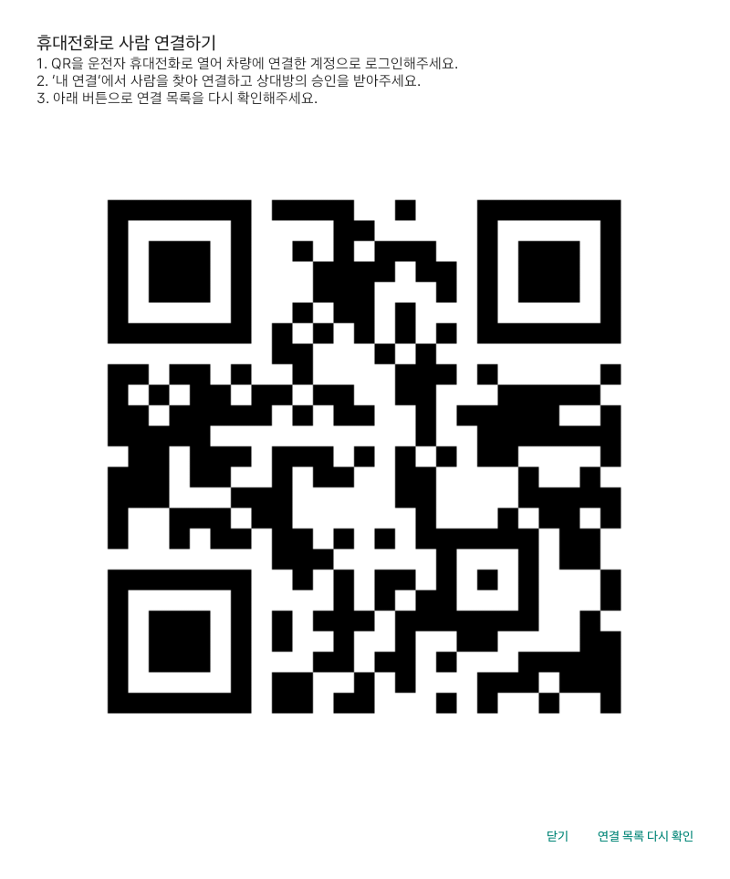

# 차량 화면

픽업 진행에 필요한 화면과 처음 설정하는 화면을 나눴다.

- **픽업**: 장소 선택 → 초대 → 준비 상태·도착 시간 → 탑승 확인 순서로 표시한다. 진행 단계에 필요하지 않은 생성·초대·완료 조작은 숨긴다.
- **마중 요청**: 받은 요청과 픽업 대기를 바로 확인한다. 연결된 사람에게 초대를 보내거나 요청을 수락할 수 있다.
- **설정**: 차량 최초 등록, 운전자 계정 연결, 음성 안내를 설정한다. 등록이 필요하면 이 화면부터 열린다.

주행 중에는 기존 조작 제한과 읽기 전용 요약을 유지한다. 시스템의 차량 영역·상태 바·내비 화면을 앱에서 다시 그리지 않는다. 앱 영역이 넓어져도 글과 버튼이 과하게 벌어지지 않도록 내용 폭을 제한한다.

가상 픽업과 장소를 사용한 화면이다. SDK에 현재 픽업의 최신 경로가 없으므로 ‘도착 시간 확인 중’을 표시한 상태다. 실제 주행 시간이 확인된 화면이나 실차 시험으로 해석하지 않는다.

`PlaceProposalScreenTest`에서 앱이 포커스를 받은 뒤 화면을 기록하고, SDK 확인 전에는 장소 확정 버튼이 꺼져 있는지 확인한다. 앱 복구·주행 제한·새 장소 경로 확인은 기존 시험과 구분한다.

## 내비 장소로 초대하기

1. 내비게이션에서 만날 장소를 검색하고 안내를 시작한다.
2. 마중의 **픽업**으로 돌아온다. 내비 연결과 장소 확인은 자동으로 진행한다. 확인 중에는 진행 표시가 나오고, 장소가 확인되면 초대 버튼이 열린다.
3. **연결된 탑승자에게 초대**를 누르고 목록에서 한 사람을 고른다. 닉네임과 마중 ID, 만날 장소를 확인한 뒤 **초대 보내기**를 누른다. 여러 사람이 연결돼 있어도 자동으로 선택하거나 일괄 전송하지 않는다.
4. 탑승자는 웹의 **픽업**에서 받은 초대를 확인하고 수락한다. 다른 사람에게도 보내려면 목록에서 다시 선택한다. 수락한 요청은 기존 픽업 대기 순서로 처리한다.

연결되지 않은 사람에게는 **초대 링크 만들기 · QR로 공유**를 사용한다. 차량 QR을 운전자 휴대전화로 열어 카카오톡 등으로 전달한다. 직접 초대 기능이 카카오톡 메시지를 대신 보내는 것은 아니다.

내비의 최종 목적지는 기본 선택된다. 태운 뒤 다른 곳으로 갈 계획이면 **다른 장소에서 태우기 · 경유지 추가**에서 최근 내비 장소를 고른다. 기존 최종 목적지는 유지하며, 경유지 추가 결과를 다시 확인한 뒤 초대한다.

장소·경로가 일치하는지 두 번 확인하는 기존 검증은 유지한다. 확인 버튼을 연속해서 누른다고 검증 시간이 줄어들지는 않는다. 내비 연결에 실패했을 때만 재확인 버튼을 표시한다. 사람을 고르는 도중 장소가 바뀌거나 주행 제한이 걸리면 전송하지 않는다.

위 이미지는 에뮬레이터에서 실행한 화면 테스트의 앱 뷰를 저장한 것이다. 가상 장소·경로를 사용했으며 실제 SDK 경로 수신이나 휴대전화 수락까지 검증했다는 뜻은 아니다. 연결된 두 사람 중 두 번째 사람을 선택해 전송하는 경우, 최종 확인 전 미전송, 확인 도중 장소가 바뀌었을 때 전송 차단을 별도로 검사한다.

## 사람 목록이 비어 있을 때

차량의 초대 대상 목록에서 **사람 연결하기**를 누르면 휴대전화 연결용 QR이 열린다. 기존에 연결된 사람이 있어도 **사람 추가**로 같은 QR을 열 수 있다. 운전자 휴대전화에서 차량과 같은 계정으로 로그인하고, 내 연결에서 상대를 찾아 연결 요청을 보낸다. 상대가 승인한 뒤 차량에서 **연결 목록 다시 확인**을 누른다. 장소가 바뀌거나 경로가 오래됐다면 픽업 화면에서 새 장소 확인이 먼저 필요하다.

이 기능은 차량에서 연결 절차를 시작하는 진입점이다. 차량 화면 안에서 사람 검색·연결 승인을 끝내는 기능은 아직 없다. QR에는 일반 마중 웹 주소만 넣으며 계정·차량 권한이나 로그인 정보는 전달하지 않는다.

## 장소 확인 대기

첫 경로 응답을 받은 뒤 5초 이상 간격으로 같은 경로를 한 번 더 받아야 초대할 수 있다. 재조회는 첫 응답 시점을 기준으로 예약한다. 안내가 없는 상태에서 안내 시작을 감지하면 다음 정기 조회를 기다리지 않고 새 검증을 요청한다. 임의로 들어온 상태 이벤트만으로 장소를 확정하지 않는다.

화면은 내비 연결, 안내 시작 필요, 경로 재확인을 구분한다. 안내가 시작되지 않았다면 로딩 표시 대신 내비에서 안내를 시작하라는 문구를 표시한다. SDK의 목적지·경유지 응답 시간과 경로 검증 시간은 남아 있어, 모든 상황에서 즉시 표시되는 것은 아니다.

설정의 **운전자 계정 연결 QR 만들기**는 차량에 운전자 본인을 연결하는 최초 설정용이다. 연결 완료 후에는 숨기며, 탑승자 추가는 **사람 연결 · 내 연결 열기**를 이용한다. 차량 계정 연결과 사람 간 연결은 서로 다른 절차다.

새로고침 버튼도 화면별로 구분한다. 설정의 **운전자 연결 상태 새로고침**은 본인 계정 연결 상태를, 마중 요청의 **요청 목록 새로고침**은 받은 요청·대기 목록을 다시 읽는다. 새 요청을 보내거나 초대를 재전송하는 버튼이 아니다.

가상 계정으로 실행한 화면 테스트의 안내창이다. QR은 공개 마중 웹 주소이며 로그인·차량 권한은 포함하지 않는다.

마중 요청 탭에는 새 초대 버튼을 중복으로 두지 않는다. 받은 요청·픽업 대기를 확인하는 화면으로 사용하며, 목록이 비었을 때는 빈 상태 안내와 픽업 탭에서 초대를 만들 수 있다는 설명을 표시한다.
