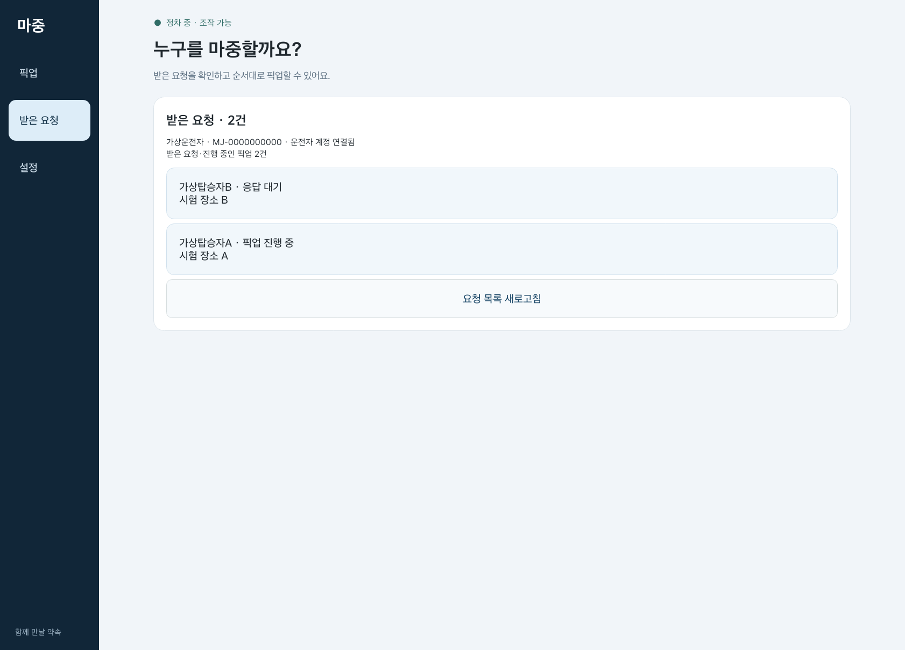
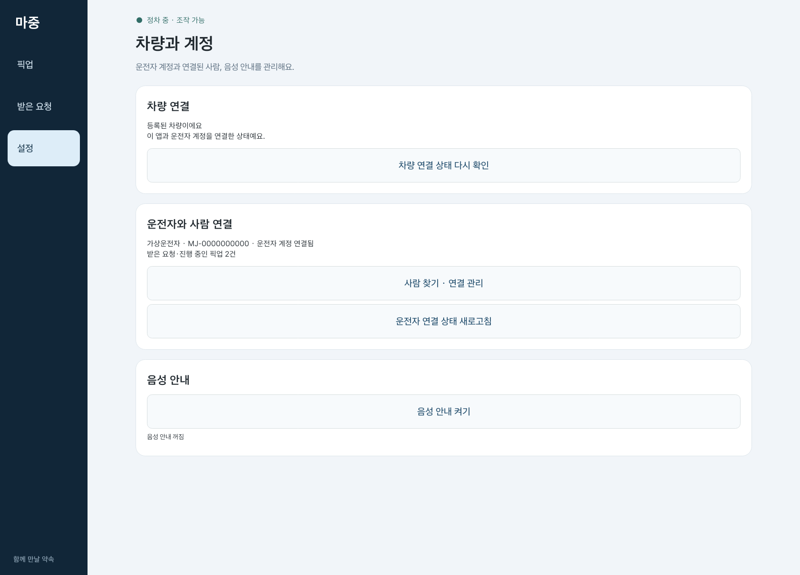
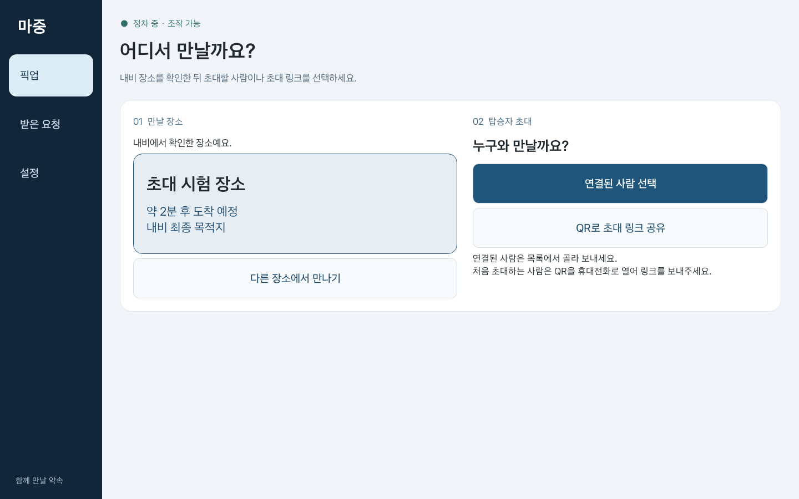
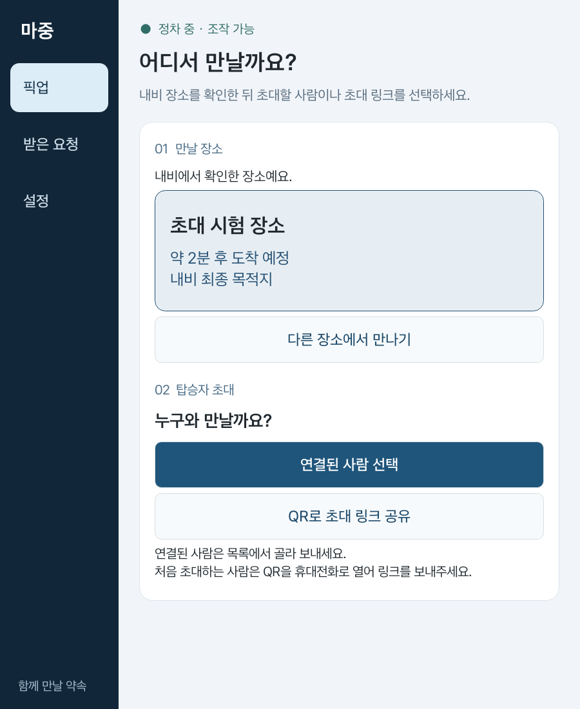
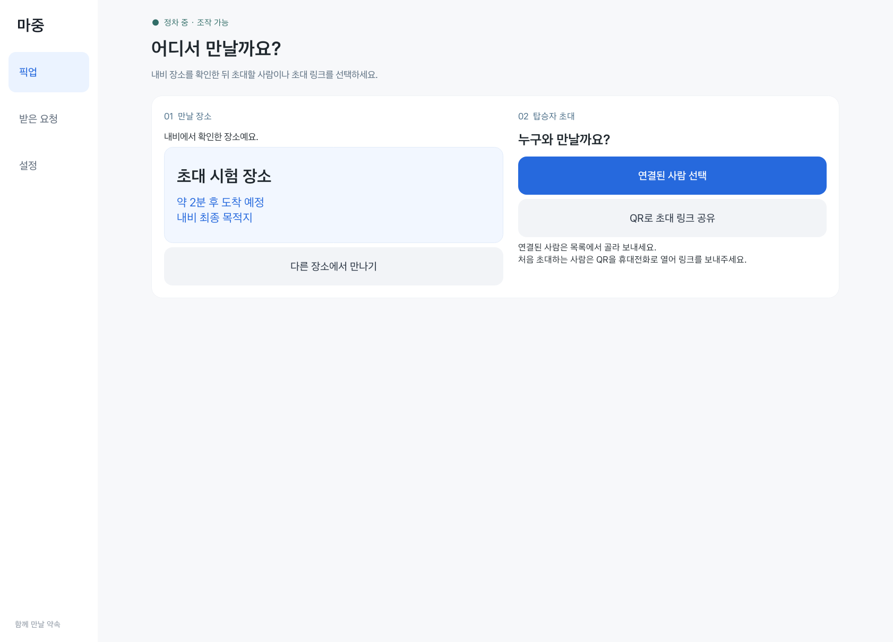
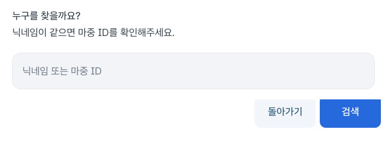

# 마중 차량 앱 화면 구성 및 이용 흐름

마중 차량 앱은 픽업 진행, 요청 관리, 차량 설정을 구분하여 구성했다.

운전자가 현재 필요한 정보와 조작을 쉽게 찾을 수 있도록 픽업 단계에 따라 화면을 변경하고, 주행 제한이 적용되면 상세 조작 대신 요약 정보를 표시한다.

이 문서는 차량 앱의 화면 구성, 주요 조작, 내비게이션 경로 확인 방식과 UI 검증 결과를 정리한 기록이다.

> 화면 이미지는 공식 Pleos 에뮬레이터의 실제 앱 뷰에 시험용 계정·장소·경로를 적용하여 수집했다. 실제 차량 주행이나 실제 휴대전화와의 통합 검증 결과는 아니다.

---

## 1. 전체 화면 구성

차량 앱은 세 가지 주요 메뉴로 구성된다.

| 메뉴 | 주요 기능 |
| --- | --- |
| **픽업** | 내비게이션 장소 확인, 탑승자 초대, 픽업 진행 및 완료 |
| **받은 요청** | 탑승자의 요청 확인·수락, 대기열 및 다음 픽업 관리 |
| **설정** | 차량 최초 등록, 운전자 계정·사람 연결, 음성 안내 |

픽업 화면에는 현재 진행 단계에 필요한 기능만 표시한다.

픽업이 시작된 후에는 불필요한 생성·초대 조작을 숨기고 준비 상태, 도착 시간, 탑승 완료 기능을 중심으로 구성한다.

### 기본 픽업 화면

가상 픽업과 장소로 구성한 화면이다.

SDK에서 현재 픽업에 해당하는 최신 경로를 확인하지 못한 상태이므로 **도착 시간 확인 중**으로 표시된다.

실제 ETA 수신이나 실차 주행 결과로 해석하지 않는다.

`PlaceProposalScreenTest`에서는 앱이 포커스를 받은 후 화면을 수집하고, SDK 경로 확인 전에는 장소 확정 버튼을 사용할 수 없는지 검사했다.

앱 복구, 주행 제한 및 새로운 장소의 실제 SDK 경로 검증은 별도의 시험 범위다.

---

## 2. 픽업 화면

픽업 화면은 내비게이션 장소를 확인하고 탑승자를 초대하는 기본 화면이다.

### 2.1 내비게이션 장소 확인

1. 차량 내비게이션에서 픽업 장소 검색
2. 경로 안내 시작
3. 마중 앱의 **픽업** 화면 이동
4. 내비게이션 연결 및 장소 확인
5. 경로 검증 완료 후 초대 방식 선택

내비게이션 경로와 장소 확인은 앱에서 진행한다.

확인 중에는 진행 상태를 표시하고, 경로 검증이 완료되면 초대 버튼을 활성화한다.

안내가 시작되지 않았다면 로딩 화면만 유지하지 않고 내비게이션에서 경로 안내를 시작하라는 문구를 표시한다.

### 2.2 초대 방식 선택

장소 확인이 끝나면 다음 두 방식 중 하나를 선택할 수 있다.

**연결된 사람 선택**

사전에 연결된 탑승자를 차량에서 직접 선택하는 방식이다.

**QR로 초대 링크 공유**

처음 이용하는 탑승자에게 초대 링크를 전달하는 방식이다.

이 이미지는 에뮬레이터에서 가상 장소·경로를 사용한 화면 테스트 결과다.

실제 SDK 경로 수신이나 휴대전화에서의 초대 수락을 함께 검증한 화면은 아니다.

---

## 3. 연결된 탑승자 초대

연결된 사람이 있다면 QR코드를 다시 전달하지 않고 차량에서 직접 초대할 수 있다.

### 이용 순서

1. **연결된 사람 선택** 누르기
2. 연결 목록에서 탑승자 선택
3. 닉네임과 마중 ID 확인
4. 현재 픽업 장소 확인
5. **초대 보내기** 선택
6. 탑승자가 모바일 웹의 **픽업**에서 초대 확인 및 수락

여러 사람이 연결되어 있어도 앱에서 자동으로 탑승자를 선택하거나 일괄 초대하지 않는다.

다른 사람에게 초대하려면 목록에서 다시 선택해야 한다.

탑승자가 수락한 요청은 기존 픽업 대기 순서에 따라 처리한다.

### 초대 전 검증

다음 조건에서는 초대를 전송하지 않는다.

- 탑승자 최종 선택 및 확인이 끝나지 않은 경우
- 선택 도중 픽업 장소가 변경된 경우
- 내비게이션 경로가 유효하지 않은 경우
- 조작 중 시스템 주행 제한이 적용된 경우

화면 테스트에서는 연결된 두 사람 중 두 번째 사람을 선택하는 경우, 최종 확인 전 미전송, 확인 중 장소 변경 시 전송 차단을 각각 검사했다.

---

## 4. QR 기반 초대

연결되지 않은 탑승자에게는 **QR로 초대 링크 공유** 기능을 사용한다.

### 이용 순서

1. 내비게이션 장소 확인
2. 차량에서 QR 초대 생성
3. 운전자 본인의 휴대전화로 QR코드 열기
4. 휴대전화 공유 화면에서 탑승자에게 링크 전달
5. 탑승자가 링크를 열어 픽업 참여

카카오톡 등의 메신저를 통해 링크를 전달할 수 있다.

차량 앱의 직접 초대 기능이 카카오톡 메시지를 자동으로 보내는 구조는 아니다.

차량에서 QR을 생성하거나 운전자 휴대전화로 열었다는 사실만으로 탑승자가 참여한 것은 아니다.

---

## 5. 픽업 장소 변경 및 경유지

기본적으로 내비게이션의 최종 목적지를 픽업 장소 후보로 사용한다.

최종 목적지와 다른 장소에서 탑승자를 태울 경우 **다른 장소에서 만나기**를 이용한다.

### 경유지 선택

1. **다른 장소에서 만나기** 선택
2. 최근 내비게이션 장소 확인
3. 픽업 장소로 사용할 지점 선택
4. 기존 최종 목적지를 유지하면서 경유지 반영
5. 내비게이션 경로 재확인
6. 검증 완료 후 탑승자 초대

경유지 추가를 요청했다는 이유만으로 장소 확인이 끝난 것은 아니다.

실제 SDK 경로와 확정할 장소가 일치하는지 확인한 후 다음 단계로 진행한다.

---

## 6. 장소 확인 및 경로 검증

내비게이션의 목적지·경유지 응답은 비동기로 전달될 수 있다.

마중은 한 번의 경로 응답만으로 초대를 허용하지 않고, 같은 경로가 유지되는지 다시 확인한다.

### 경로 재확인 기준

1. 첫 번째 경로 응답 수신
2. 동일 경로의 추가 확인 요청
3. 두 응답 사이의 실제 간격 확인
4. 경로 및 장소 일치 여부 확인
5. 조건 충족 시 초대 활성화

첫 경로 응답 이후 **최소 5초 간격**으로 동일한 경로를 다시 확인해야 한다.

재조회는 첫 응답 시점과 측정된 SDK 응답 소요 시간을 고려하여 예약한다.

다음 조회를 조금 일찍 시작해 응답 대기 시간을 겹칠 수 있지만, 실제 두 응답의 간격이 5초 미만이면 검증을 완료하지 않는다.

### 안내 시작과 재조회

내비게이션 안내 시작을 감지하면 다음 정기 조회를 기다리지 않고 새로운 경로 검증을 요청한다.

임의로 수신한 상태 이벤트만으로 장소를 확정하지 않는다.

화면에서는 다음 상태를 구분한다.

- 내비게이션 연결 중
- 경로 안내 시작 필요
- 첫 경로 확인
- 경로 재확인
- 장소 확인 완료
- 경로 확인 실패

SDK 응답과 경로 검증에는 실제 처리 시간이 필요하므로 모든 상황에서 장소가 즉시 표시되는 것은 아니다.

재확인 버튼은 내비게이션 연결 실패 등 재시도가 필요한 경우에만 표시한다.

버튼을 반복해서 눌러도 검증 조건이나 대기 시간이 단축되지는 않는다.

---

## 7. 사람 연결 및 검색

초대할 사람이 없는 경우 차량에서 사람 연결 메뉴로 이동할 수 있다.

### 사람 목록이 비어 있을 때

**사람 연결하기** 또는 **사람 추가**를 선택하면 사람 연결 화면이 열린다.

설정의 **사람 찾기 · 연결 관리**에서도 같은 기능을 사용할 수 있다.

### 연결 순서

1. 닉네임 또는 마중 ID로 사람 검색
2. 검색 결과에서 대상 확인
3. 연결 요청 전송
4. 상대방 승인 대기
5. 연결 완료 후 초대 목록에서 대상 선택

받은 연결 요청은 차량에서 승인하거나 거절할 수 있다.

닉네임이 같은 사용자는 마중 ID로 구분한다.

요청을 보낸 사용자가 자신의 연결 요청을 직접 승인할 수는 없다.

사람 연결만으로 차량 위치 공유나 픽업이 시작되지는 않는다.

### 연결 화면의 안전 처리

- 정차 중에만 상세 조작 허용
- 운전자 계정 변경 시 이전 검색·연결 결과 사용 제한
- 진행 중 계정 상태가 달라지면 결과 재확인
- 로그인 정보 또는 차량 접근 권한이 포함되지 않은 안내용 QR 사용

가상 계정을 이용한 화면 테스트 결과다.

표시된 QR은 공개 마중 웹 주소를 안내하는 용도이며, 로그인 정보나 차량 권한을 포함하지 않는다.

---

## 8. 받은 요청 및 픽업 대기

**받은 요청** 화면에서는 탑승자가 보낸 요청과 현재 대기열을 관리한다.

### 주요 화면 구성

- 탑승자 닉네임 및 마중 ID
- 요청 상태
- 픽업 장소
- 요청 수락 및 거절
- 대기 중인 픽업
- 다음 픽업 준비

요청 항목을 선택하면 해당 요청의 수락·거절 또는 픽업 시작 과정을 확인할 수 있다.

요청이 없는 경우에는 빈 상태 안내를 표시한다.

새로운 직접 초대 버튼을 중복 배치하지 않고, 픽업 화면에서 초대를 만들 수 있다는 안내를 제공한다.

### 순차 처리

여러 요청을 받아도 실제 진행 중인 픽업은 한 건만 유지한다.

현재 픽업이 끝나면 다음 요청의 장소와 경로를 확인한 후 이어서 진행한다.

[요청에서 픽업 시작하기](request-pickup-flow.md)

---

## 9. 설정 화면

설정에서는 차량 등록, 운전자 계정, 사람 연결 및 음성 안내를 관리한다.

### 주요 항목

| 항목 | 기능 |
| --- | --- |
| 차량 최초 등록 | 차량 등록 및 운전자 계정 연결 |
| 운전자 계정 | 현재 연결된 계정 확인 |
| 사람 찾기 · 연결 관리 | 검색·연결 요청·승인·해제 |
| 음성 안내 | 준비 상태 및 도착 음성 안내 설정 |

### 최초 연결 QR

**운전자 계정 연결 QR 만들기**는 차량을 운전자 본인 계정과 연결하는 기능이다.

연결이 완료되면 일반적인 초기 연결 단계에서는 해당 버튼을 숨긴다.

이후 탑승자 추가는 **사람 찾기 · 연결 관리**를 이용한다.

차량과 운전자 계정 연결, 사람 간 연결, 픽업 QR 초대는 서로 다른 절차다.

### 새로고침 기능

화면별로 새로고침의 대상도 구분한다.

| 기능 | 동작 |
| --- | --- |
| 운전자 연결 상태 새로고침 | 현재 운전자 계정 연결 상태 재조회 |
| 요청 목록 새로고침 | 받은 요청 및 픽업 대기 목록 재조회 |

새로고침은 기존 상태를 다시 읽는 기능이다.

새로운 요청을 생성하거나 기존 초대를 재전송하지 않는다.

---

## 10. 주행 중 화면 제한

차량 앱은 시스템의 CarUxRestrictions를 따른다.

주행 제한이 적용되면 상세 조작을 제한하고 읽기 전용 요약 화면을 표시한다.

### 제한 대상

- 새로운 탑승자 검색 및 연결
- 초대 대상 선택
- 픽업 요청 수락·거절
- 장소 변경 및 경로 확정
- 계정 연결 및 설정

위 조작은 안전하게 정차한 상태에서 진행한다.

차량 앱은 시스템의 상태 바나 내비게이션 화면을 직접 다시 구현하지 않는다.

주행 제한 및 차량 시스템 UI는 플랫폼이 제공하는 범위를 사용한다.

[주행 중 요약 화면](driving-summary.md)

---

## 11. 화면 배치 및 반응형 처리

차량 디스플레이의 가용 영역과 글자 크기에 따라 화면을 조정한다.

### 넓은 화면

넓은 화면에서는 장소 확인과 초대 관련 영역을 구분해 배치한다.

콘텐츠 폭을 제한해 화면이 넓어져도 버튼과 글자가 과도하게 벌어지지 않도록 구성한다.

### 좁은 화면 및 큰 글씨

가용 폭이 좁으면 장소와 초대 영역을 세로로 배치한다.

해당 화면의 시험 조건은 다음과 같다.

- 루트 뷰 폭: 900dp
- 글자 크기: 1.3배
- 시험용 계정 및 장소 사용

넓은 화면은 루트 뷰를 1440 × 900dp로 측정했다.

받은 요청과 설정 화면은 Activity 창 크기를 기준으로 저장했다.

이 수치는 에뮬레이터 화면 테스트의 측정 조건이며, 실제 차량 디스플레이의 검증 결과는 아니다.

---

## 12. UI 개선 기록

### 2026년 10월 27일 — 화면 배치

픽업, 받은 요청, 설정을 분리하고 각 화면에 필요한 정보와 조작을 배치했다.

주요 변경 사항:

- 픽업 단계에 따라 불필요한 버튼 숨김
- 장소 확인과 초대 방식 구분
- 연결된 사람 선택 및 최종 확인
- 요청 목록의 사람·상태·장소 묶음 표시
- 빈 목록 안내 개선
- 좁은 화면에서 콘텐츠 배치 조정

### 2026년 10월 28일 — 밝은 메뉴와 입력창

기존의 짙은 사이드바를 밝은 배경으로 변경했다.

선택된 메뉴와 주요 동작은 파란색으로 구분하고, 보조 버튼에는 회색 배경을 사용했다.

사람 검색 입력창도 밑줄 형태에서 독립된 입력 영역으로 변경했다.

- 입력창 높이: 72dp
- 좌우 여백: 24dp
- 주요 동작과 보조 동작의 시각적 구분

**픽업 화면**

**사람 검색 입력창**

위 이미지는 별도 에뮬레이터에서 가상 계정·장소로 확인한 화면이다.

[차량 UI 점검 기록](ui-audit-2026-10-28.md)

---

## 13. 화면 및 기능 검증 범위

### 수행한 시험

- 차량 앱 단위 테스트
- Android Lint 검사
- APK 빌드
- 사람 검색 및 연결 목록 표시
- 연결된 두 번째 사람 선택
- 최종 확인 후 초대 전송
- 장소 변경 중 초대 전송 차단
- SDK 경로 확인 전 장소 확정 버튼 비활성화
- 초기 계정 연결 화면 상태 유지
- 차량 상태 유실 시 메뉴 숨김 및 창 닫힘
- 좁은 화면의 영역 겹침 확인
- 버튼 글자 잘림 확인

### 별도 검증이 필요한 항목

- 실제 SDK 경로를 수신한 전체 초대 흐름
- 실제 휴대전화에서 초대 수락
- P → D → P 주행 제한 전환 재시험
- 앱 종료 및 복구 과정의 화면 연속성
- 실제 차량 디스플레이별 화면 배치
- 실제 차량 환경에서의 조작 제한
- 실차 주행 중 동작

일부 기능은 다른 테스트에서 확인한 기록이 있지만, 이 문서의 UI 변경 시험에서 다시 실행한 결과와 구분한다.

시험 데이터와 화면 캡처에는 실제 사용자의 이름, 위치 또는 초대 토큰을 포함하지 않았다.

---

## 14. 관련 문서

- [차량 앱 README](../README.md)
- [차량 최초 연결](vehicle-enrollment.md)
- [계정 및 요청](vehicle-account-requests.md)
- [요청 픽업 흐름](request-pickup-flow.md)
- [차량 화면 구조](vehicle-screen.md)
- [주행 중 요약 화면](driving-summary.md)
- [UI 점검 기록](ui-audit-2026-10-28.md)
- [저장 및 복구](pickup-recovery.md)
- [프로젝트 전체 아키텍처](https://github.com/majung-team/majung/blob/main/docs/architecture.md)

화면 구성은 기능 변경에 따라 달라질 수 있으며, 날짜가 포함된 이미지는 해당 시점의 UI 검증 기록으로 유지한다.
