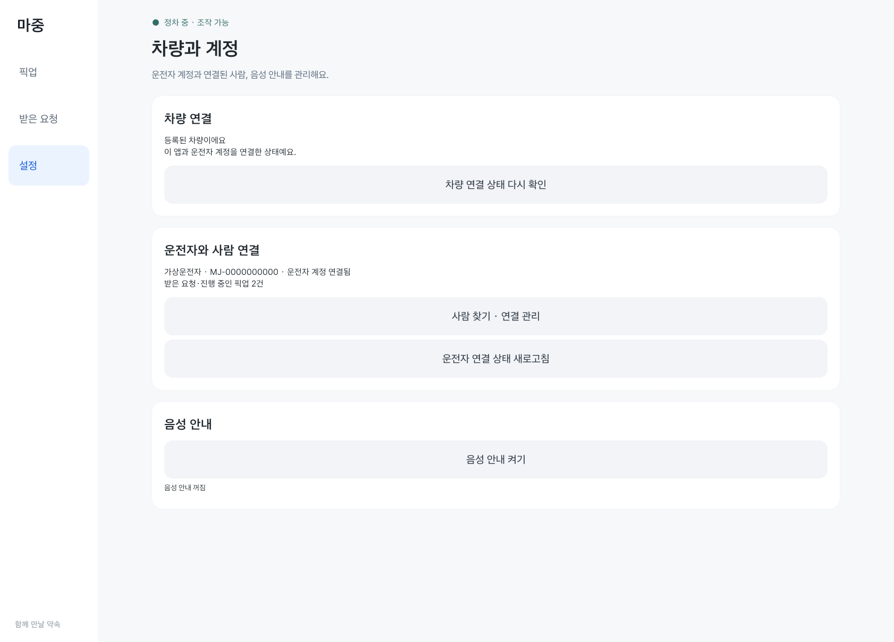
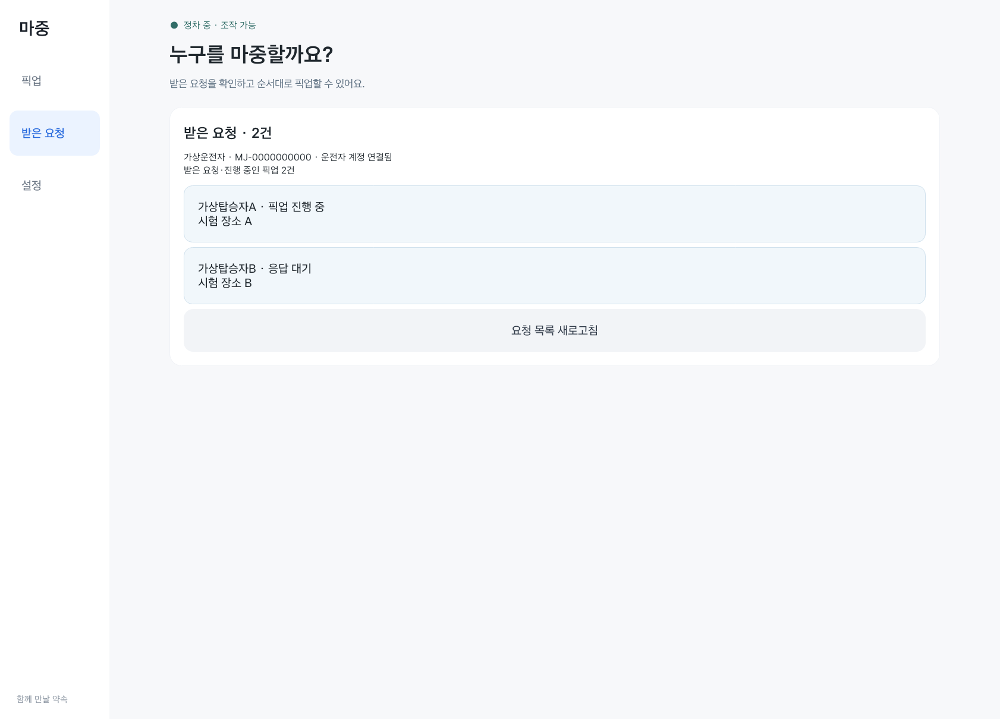

# 차량 화면 점검 · 2026년 10월 28일

## 수정한 부분

- 기본 Android 버튼의 elevation·translationZ·StateListAnimator가 둥근 배경 아래에 남기던 그림자를 제거했다. 공통 버튼, 메뉴, 요청 목록, 팝업 버튼에 같은 처리를 적용했다.
- 메뉴 전환은 이전 화면을 100ms 동안 내보낸 뒤 다음 화면을 220ms 동안 들여온다. 좌우 방향은 메뉴 순서를 따른다.
- 본문 영역 안에서만 움직이도록 별도 컨테이너로 잘랐다. 사이드바 위로 본문이 겹치지 않는다.
- 연속 선택은 이전 전환을 취소한다. 같은 메뉴 선택, 화면 이탈, 주행 제한에서도 투명도와 이동 위치를 복원한다. 시스템 애니메이션이 꺼져 있으면 즉시 이동한다.
- 도착 시간을 표시하지 않는 단계에서는 비어 있는 ETA 영역을 숨겨 준비 상태 문장이 불필요하게 좁아지지 않게 했다.

## 확인한 화면과 조건

별도 Pleos 에뮬레이터와 가상 계정·장소를 사용했다. 사용자 에뮬레이터의 계정이나 픽업은 변경하지 않았다.

| 화면 | 확인 내용 |
| --- | --- |
| 픽업 장소·초대 | 900×1100, 1440×900dp에서 버튼 글자 잘림과 양쪽 열 겹침 검사 |
| 받은 요청 | 긴 이름·장소 줄바꿈, 요청 행의 모서리와 그림자 확인 |
| 설정 | 차량 연결·사람 연결·음성 안내 버튼 모양 확인 |
| 사람 검색·QR·확인 창 | 입력창 여백과 버튼, 연결 흐름 회귀 시험 |
| 메뉴 전환 | 좌우 이동 발생·완료 위치·빠른 연속 선택 확인 |
| 제한·복구 | 정책이 미확인으로 바뀌면 조작·팝업 숨김, 기존 픽업 복구 시험 |

계정 시험 6개, 복구 시험 4개, 읽기 전용 요약 시험 1개 통과. 실제 P→D→P 수동 전환 시험은 이번에는 실행하지 않았다. 디버그 APK·시험 APK·단위 시험·lint 통과.
실차와 실제 휴대전화의 종합 검증을 대신하는 결과는 아니다.

