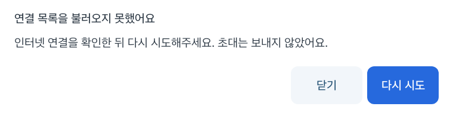

# 사람 연결과 초대 과정 점검

2026년 10월 28~29일 별도 Pleos 에뮬레이터와 가상 계정으로 점검했다. 사용 중인 에뮬레이터의 계정·픽업·설치 앱은 변경하지 않았다.

## 고친 부분

- 설정에서 휴대전화 사람 연결 QR을 연 뒤 `연결 목록 다시 확인`을 눌러도 내비 장소가 없으면 아무 화면도 열리지 않았다. 이제 `연결된 사람 보기`로 연결 목록을 연다. 장소 선택은 초대할 때 확인한다.
- 연결된 탑승자 목록을 가져오는 동안 진행 안내를 띄운다. 실패하면 초대를 보내지 않았다는 안내와 `다시 시도`를 보여준다.
- 조회 중 닫으면 뒤늦게 응답이 와도 사람 선택 창을 다시 열지 않는다. 차량 권한이나 운전자 계정이 바뀐 경우에도 이전 조회 결과를 표시하지 않는다.
- 실패 안내가 열린 사이 운전자 연결이 해제되면 재시도에서 대기 창을 열지 않고 재연결 안내를 표시한다. 이 경계를 포함한 계정 화면 시험 6개도 다시 통과했다.
- 닉네임 검색에서 키보드의 검색 동작도 화면의 검색 버튼과 같은 검사를 거친다.
- 휴대전화 안내에 남아 있던 `내 연결` 메뉴명을 실제 `사람 찾기`로 바꿨다.

## 확인한 범위

- 단위 시험·debug 빌드·lint 통과.
- 독립 에뮬레이터 시험 10개 통과: 사람 검색·선택·초대, 실패 후 재시도, 조회 중 닫기, 장소 없는 연결 목록 이동, 계정 새로고침, 내비 연결 시간 초과, 도착 재시도, 위치 정보 유효성, 준비 상태 수신 포함.
- 팝업 버튼 경계와 좁은 화면·넓은 화면 배치는 기존 화면 시험에서 함께 확인했다.
- 새 로컬 Spring 서버와 Pleos SDK를 연결한 대기 픽업 시험 1개가 35.418초에 통과했다. 첫 픽업 중 새 요청 수락, 첫 픽업 완료, 다음 장소 경유지 추가, SDK ETA 공유, 준비 상태 수신, 도착·완료, 종료 후 조회 차단을 확인했다. 시험의 도착 요청도 조회한 장소 버전을 명시하도록 맞췄다. [항목별 결과](evidence/usability-queue-sdk-2026-10-29.json)

실제 휴대전화와 실차 시험은 별도다. 주행 중 조작을 허용하도록 변경하지 않았다.

