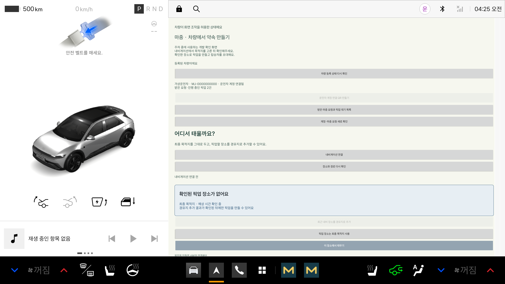

# 운전자 계정과 여러 탑승자의 마중 요청

운전자만 차량과 계정을 연결한다. 탑승자는 연결한 적 없는 운전자에게도 검색으로 마중 요청을 보낼 수 있다. 한 차량에 한 명의 탑승자만 등록하는 구조가 아니다.

## 차량에서 사용하는 순서

1. 관리자 등록 코드로 차량 최초 등록을 마친다.
2. **운전자 계정 연결 QR 만들기**를 누르고 운전자 휴대전화로 스캔한다.
3. 휴대전화에서 카카오 로그인·닉네임 설정 후 차량 연결을 요청한다.
4. 차량에서 닉네임과 마중 ID를 확인하고 **연결 승인**을 누른다. 휴대전화 요청만으로는 계정을 연결하지 않는다.
5. **받은 마중 요청과 픽업 대기 목록**을 연다. 요청한 사람·장소를 보고 수락하거나 거절한다. 수락 순서대로 대기에 추가된다.
6. 현재 픽업을 마치고 **다음 픽업 준비**를 누른다. 다음 요청 장소를 내비 경유지에 추가한다.
7. SDK에서 같은 좌표의 경로가 확인되면 **이 픽업 시작**을 누른다. 계속하기로 위치 공유를 확인한다. 진행 중인 픽업이 있으면 다음 픽업 시작을 차단한다.

차량당 운전자 계정 하나를 연결하며 계정 하나에 여러 차량을 연결할 수 있다. 탑승자는 이 연결 수에 포함되지 않는다. 다른 사람을 태우는 동안에도 여러 요청을 받아 대기에 넣을 수 있다.

## 파일

| 파일 | 역할 |
| --- | --- |
| VehicleAccountController.kt | 등록 차량 권한으로 운전자 연결·받은 요청 조회·수락·거절 |
| VehicleAccountSection.kt | 계정 QR, 본인 확인, 요청·대기 목록과 시작 화면 |
| PickupController.startRequested | 수락한 요청을 기존 픽업 제어·저장·위치 공유 흐름에 연결 |
| MainActivity.kt | 화면에 새 영역 연결, 화면이 켜진 동안 10초 조회 |

기존 차량 조작 제한을 그대로 적용한다. 주행 제한 상태에서는 수락·QR·경유지 변경·픽업 시작 버튼과 열린 확인창을 사용할 수 없다. 앱이 닫혀 있을 때 새 요청을 깨워 알리는 푸시는 아직 없다.

## 오류·재접속

- 계정 QR은 5분, 새 QR 발급 시 이전 QR은 사용할 수 없다.
- 차량 등록 권한을 다시 확인하는 동안 계정 QR·요청 처리 결과를 적용하지 않는다.
- 통신 실패한 수락·거절·연결 승인은 자동으로 재전송하지 않는다. 조회로 결과부터 확인한다.
- 시작 응답을 잃으면 같은 요청에서 복구한다. 서버는 같은 pickupId의 차량 접근 권한만 교체하며 두 번째 픽업을 만들지 않는다. 결과가 불확실한 동안 일반 새 픽업 만들기는 잠근다.
- 재시작 후 기존 암호화된 픽업 접근 정보를 복원한다. 정보가 저장되지 못했거나 복원할 세션이 없으면 받은 요청 목록의 ‘진행 중인 픽업 복구’를 사용한다.
- 탑승자 취소·만료와 앞선 픽업 완료 여부는 시작 시 서버에서 다시 확인한다.

## 검증 범위

작업 브랜치 기준: APK 빌드, 기존 단위 시험, 에뮬레이터의 HTTP 시험 서버로 차량 권한 전달·명시적 계정 승인·두 요청 목록·수락·쓰기 실패 자동 재시도 금지·잘못된 응답 처리를 확인했다. 실제 서버의 요청 시작·순서 제어와 웹 상태는 로컬 Spring 서버·가상 계정으로 확인했다.

새 흐름의 공개 서버 배포, 실제 휴대전화 GPS, 실차 확인은 아직 완료로 기록하지 않는다. 현재 위치 외 장소 검색은 별도 작업이다. 과거 공개 HTTPS 픽업 시험 기록은 기존 초대 방식의 결과다.

에뮬레이터 단위 시험 35개, 계정 연결·화면 3개와 기존 등록 시험 6개(계측 시험 총 9개)가 통과했다. 아래 목록은 HTTP 시험 서버의 가상 운전자·탑승자 두 명으로 표시한 화면이다. 실제 두 휴대전화나 실차 시험으로 해석하지 않는다.

