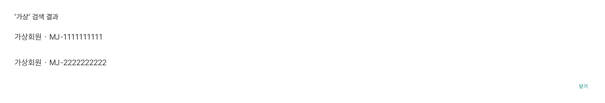

# 차량에서 사람 찾기

1. 안전하게 정차한 뒤 **설정 → 사람 찾기 · 연결 관리**를 연다.
2. **닉네임·마중 ID로 사람 찾기**에서 두 글자 이상 입력해 검색한다.
3. 닉네임과 마중 ID를 보고 사람을 고른 뒤 **연결 요청 보내기**를 누른다.
4. 상대방이 승인하면 픽업 화면의 초대 대상 목록에 나타난다. 차량 위치는 아직 공유하지 않는다.

**연결 요청·연결된 사람 보기**에서 보낸 요청·받은 요청을 확인한다. 받은 요청은 승인·거절, 보낸 대기 요청은 취소할 수 있다. 연결 해제는 기존 휴대전화 내 연결 화면에서 처리한다. 처리 결과를 확인하지 못하면 재전송하기 전에 목록을 다시 확인한다. 조회가 쓰기 요청을 자동으로 반복하지 않는다.

차량에서는 승인된 운전자 계정으로만 처리한다. 검색 결과를 연 사이 계정이나 차량 권한이 바뀌면 결과를 버리고 다시 확인한다. 주행 제한이 걸리면 검색·확인창을 닫고 조작을 막는다.

화면 테스트의 가상 회원이다. 같은 닉네임 두 사람 중 마중 ID로 두 번째 사람을 선택하고 확인 전 미전송, 확인 후 지정 수신자 요청 전송을 검사했다. 실제 상대방 휴대전화 승인까지 수행한 시험은 아니다.

## 장소 확인

첫 SDK 응답으로 받은 이름은 먼저 표시하며, 경로 확인 전에는 초대와 ETA를 열지 않는다. 2026-10-27 별도 Pleos 에뮬레이터 단일 시험에서 이름 표시 약 5초, 초대 가능 상태 약 10초를 측정했다. 안내 시작 지연을 포함한 한 차례 측정으로 평균·보장 시간이 아니며 실제 차량 속도를 의미하지 않는다.

## 차량 ID

마중 서버가 발급한 앱 등록 식별자다. VIN이나 제조사가 보증한 차량 소유권 인증으로 표시하지 않는다.
