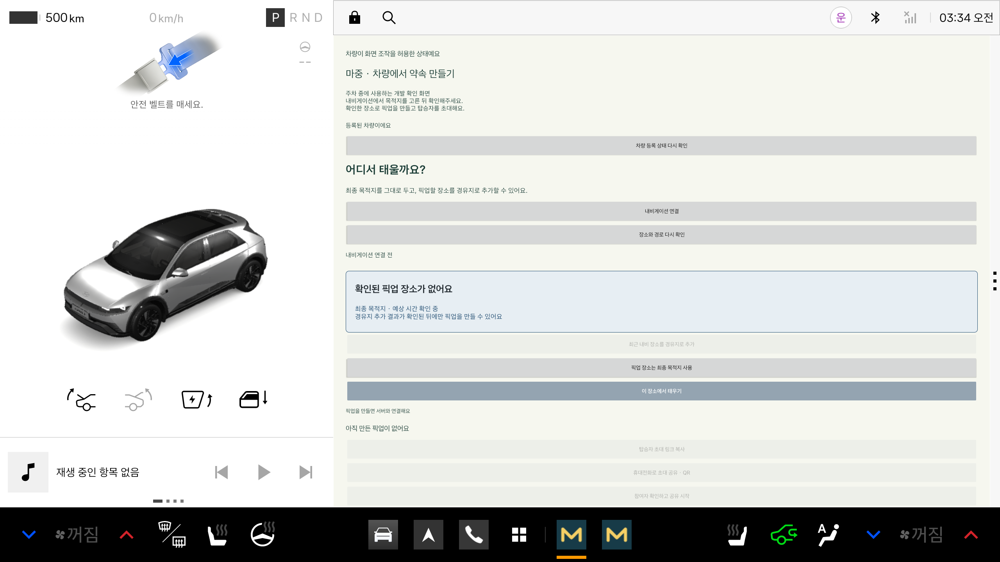

# 차량 최초 등록과 공개 서버 연결

> 관리자 코드 기반 초기 구현·2026-10-25 시험 기록이다. 현재 일반 사용자는 [QR 최초 연결](vehicle-enrollment.md)로 시작한다. 아래 미확인 항목도 당시 기준이며 최신 APK·계정 연결 결과는 [README](../README.md)를 본다.

차량 앱은 관리자가 발급한 일회용 코드를 최초 한 번 입력해 등록한다. 이후 픽업은 저장된 차량 권한으로 만들고, 픽업마다 등록 코드를 요구하지 않는다. 공통 관리자 키는 서버에만 둔다.

## 처음 사용하는 순서

1. 서버 관리자가 등록 코드를 발급한다. 발급 방법은 [서버 안내](https://github.com/majung-team/majung-backend/blob/main/docs/vehicle-registration.md)를 따른다.
2. 주차 상태에서 **차량 최초 등록**을 누르고 코드를 입력한다.
3. 등록에 성공하면 입력값을 지우고 차량별 권한을 Android Keystore로 암호화해 저장한다.
4. 앱을 다시 열면 저장한 권한으로 서버 확인을 거친 뒤 픽업을 만들 수 있다.

아래는 공개 서버가 등록 권한을 확인한 Pleos 에뮬레이터 화면이다. 최종 디자인과 실차 화면을 뜻하지 않는다.



차량 등록은 장치 권한이다. 카카오 운전자 계정과 차량을 연결한 것은 아니며, 계정·차량 연결은 이 기반 위에서 별도로 구현한다.

## 실패했을 때

- 등록 코드가 만료됐거나 이미 사용됐다면 새 코드를 요청한다.
- 등록 응답을 받지 못했거나 안전한 저장에 실패하면 자동으로 다시 등록하지 않는다. 관리자에게 코드 사용 여부를 확인한다.
- 서버에 일시적으로 연결할 수 없으면 기존 권한을 지우거나 재등록하지 않는다. **차량 등록 상태 다시 확인**으로 재시도한다. 확인 전에는 픽업 생성과 최초 등록을 막는다.
- 실제로 권한이 철회됐거나 유효하지 않다는 응답을 받으면 저장된 권한을 지우고 새 코드를 요청하도록 안내한다.
- 암호문 변조나 키 손실을 감지하면 저장값을 지운다. 삭제마저 실패하면 재등록을 막는다.

차량 권한과 픽업 접근 정보는 파일·키를 따로 사용한다. 픽업을 마치면 픽업 접근 정보만 정리하고 차량 등록은 유지한다. 서버 주소도 암호화의 확인 값에 포함하므로 다른 서버로 빌드를 바꿨을 때 이전 서버의 권한을 그대로 사용하지 않는다.

## 공개 HTTPS 빌드

```sh
./gradlew :vehicle:assembleDebug :vehicle:assembleDebugAndroidTest -PpickupApi=https://majung.cloud
```

`pickupApi`에는 경로·쿼리·사용자 정보가 없는 HTTPS origin만 허용한다. 별도 설정이 없는 debug 빌드는 기존 로컬 주소를 사용한다. release에서 서버를 사용하려면 주소를 명시해야 하며, 실제 배포 서명 설정은 별도다.

차량 QR은 `#share` 공유 화면을 연다. 운전자 휴대전화에서 탑승자에게 `#join` 참여 링크를 전달한다. 공유 화면을 여는 것만으로 탑승자가 참여하지 않는다. 초대가 바뀌거나 종료되면 이전 QR 창을 닫는다. 실제 휴대전화 카메라 스캔은 아직 확인하지 않았다.

## 코드 위치

| 파일 | 역할 |
| --- | --- |
| VehicleRegistrationController.kt | 등록 상태 조회·코드 제출·오류 구분·생성 허용 여부 |
| VehicleCredentialStore.kt | 별도 Keystore 키와 AES-GCM 암호문 파일, 백업 제외 |
| VehicleRegistrationSection.kt | 주차 중 코드 입력과 상태 재확인 |
| PickupApiClient.kt | 일반 API 경로·차량 Bearer 권한 전송 |
| PickupController.kt | 검증된 차량 권한으로 생성, 픽업별 권한과 분리 |
| InvitationQr.kt | HTTPS 공유 주소의 QR 이미지 생성 |

## 확인한 범위

2026-10-25 기준:

- 단위 시험 35개, debug APK·androidTest APK 빌드와 lint 통과
- 공식 Pleos 에뮬레이터의 등록 시험 6개 통과: 암호화·변조 감지, 픽업 저장소와 분리, QR 주소 확인, 등록·복원·Bearer 전송·철회, 삭제 실패, 서버 장애 시 재등록 차단, 코드 만료·저장 실패·재시도 금지
- 공개 HTTPS 통합 시험 통과: 최초 등록·권한 저장, 승인 전 차단, SDK 위치·ETA 전송, 준비 상태, 수동 도착·탑승 완료, 완료 후 접근 차단
- 앱 실제 강제 종료 후 새 프로세스에서 코드 없이 권한 복원·서버 재확인 통과

[공개 HTTPS 결과](evidence/public-https-2026-10-25.json)와 [강제 종료 후 복원 결과](evidence/public-vehicle-recovery-2026-10-25.json)는 식별값을 제외한 요약이다. 이전 2026-10-24 브라우저 시험 기록은 별도 날짜로 유지한다. 이번 공개 통합 시험의 탑승자 동작은 API로 수행했으며 실제 휴대전화 시험으로 합산하지 않는다.

실차, 실제 휴대전화 QR 스캔, release 서명·배포, 카카오 계정과 차량 연결은 미확인 또는 후속 작업이다. SDK 목적지와 수동 도착을 사용한 이번 시험으로 모든 경유지·자동 도착을 검증했다고 보지 않는다.

공개 서버 통합 시험은 기본 실행에서 건너뛴다. 시험 장치의 앱 전용 `files/public-registration-code`에 새 일회용 코드를 준비한 뒤 `PublicHttpsPickupTest`에 `publicHttps=true`를 전달한다. 입력 파일은 사용 즉시 지운다. 이후 앱을 실제 강제 종료하고 `PublicVehicleRecoveryTest`에 `publicRecovery=true`를 전달해 새 프로세스의 복원을 확인한다. `PublicBrowserPickupTest`는 `publicBrowser=true`일 때 별도 브라우저 작업자와 진행한다. 시험용 등록 권한도 공개 파일·명령 인자·기록에 남기지 않는다.
