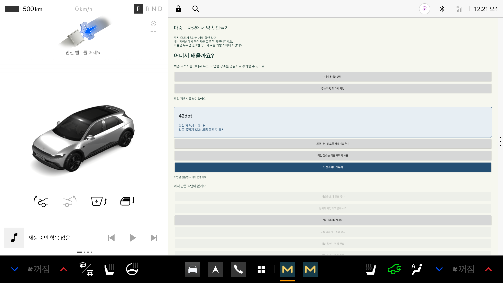

# 경유지 좌표 누락 처리

**10월 29일 재확인:** 마중의 경유지 연결·ETA·새 연결 복구는 통과했다. SDK 원본의 `(0, 0)` 반환은 남아 있으며 [제공 측 확인 자료](waypoint-provider-report.md)로 따로 추적한다. 앱 기능 실패와 제공 측 응답 문제를 같은 완료 상태로 묶지 않는다.

## 어떤 문제가 있었나

공식 Pleos Connect Emulator 2.1.0 ARM64, NaviHelper 3.0.5에서 경유지의 위도·경도가
모두 0으로 반환됐다. 내비게이션 앱 버전은 `3.3.2-rc5-hotfix.3`이다.
`addWaypoint()`와 `requestRouteWithWaypoints()`에서 같은 현상을 확인했다.
경유지와 최종 목적지의 예상 시간은 서로 다르게 반환됐다.

처음에는 SDK가 발급한 장소 ID가 있는 곳만 연결했다. ID 없는 장소는 생성이 막혀 있었으므로
그 처리만으로 기능을 완료할 수 없었다.

## 현재 처리

사용자가 장소를 선택하면 다음 순서로 진행한다. ID를 직접 입력할 필요는 없다.

1. 외부 장소 ID가 있으면 그 ID를 유지한다.
2. ID가 없으면 마중이 `majung:` 네임스페이스의 무작위 식별자를 발급한다.
   기존 업체의 장소 ID를 만들어내거나 다른 장소의 ID를 빌리지 않는다.
   SDK 요청의 `poiProvider`에도 `majung`을 명시한다.
3. 선택한 실제 좌표와 식별자를 함께 경유지 추가 API로 보낸다.
4. SDK가 같은 식별자를 가진 경유지를 정확히 하나 반환했는지 확인한다.
5. 기존 최종 목적지·경유지가 유지되고 요청한 지점 하나가 추가됐는지 두 차례 확인한다.
6. 좌표 누락 응답은 확인된 요청 좌표와 연결한다. ETA는 해당 경유지 응답의 값을 사용한다.

공식 에뮬레이터에서 마중 식별자가 경유지 응답에 유지됐고,
최근 장소 목록에도 같은 식별자와 요청 좌표가 함께 반환됐다.
[SDK 확인 결과](evidence/waypoint-app-identity-probe-2026-10-24.json)에 횟수와 일치 여부를 기록했다.
이 동작은 위 버전의 실제 시험 결과이며, 문서에 모든 내비게이션 구현의 지원이 보장된 것으로 쓰지 않는다.

최종 목적지 ETA, 장소 이름, 경유지 순번으로 추측하지 않는다.
같은 이름의 장소도 식별자가 다르면 구분한다. 여러 경유지의 순서가 바뀌어도 각각 대조한다.
정상적인 다른 좌표가 반환되면 이전 요청 좌표로 덮어쓰지 않는다.

**입력에 ID가 없는 경우와 응답에서 식별자가 사라진 경우는 다르다.**
입력에는 마중이 ID를 발급하므로 생성할 수 있다. 발급한 ID가 응답에서 누락·불일치·중복되면
요청한 장소인지 확인할 수 없으므로 생성·공유를 차단한다.

## 저장과 재연결

경유지 식별자는 기존 픽업 접근 정보와 함께 Keystore의 AES-GCM으로 암호화해 저장한다.
위치·ETA·장소 이름을 로컬 저장 항목에 추가하지 않는다.

재실행하면 서버에서 확정된 장소를 다시 받는다. 사용자가 공유 재개를 선택한 뒤,
저장한 식별자와 새 SDK 경유지 응답을 대조한다. 예전 위치·ETA는 재사용하지 않는다.
완료·취소·접근 거절 시 식별자도 다른 접근 정보와 함께 삭제한다.
식별자 필드가 없는 기존 세션은 이전 형식대로 읽는다.

## SDK 원본 응답과 조사 범위

SDK의 원본 경유지 좌표가 0인 현상은 재현된다. 마중은 검증된 요청 정보로 좌표를 연결한다.
공식 시스템 이미지에서 응답 경로를 읽기 전용으로 확인했을 때, 경유지는 엔진 좌표를 그대로 전달했다.
최종 목적지에는 0 좌표를 원래 목적지 좌표로 보정하는 코드가 있지만 경유지에는 같은 보정이 없었다.
엔진 내부에서 0 좌표가 만들어지는 이유까지 입증한 것은 아니다.

처음부터 요청 정보가 없고 SDK가 좌표와 식별자를 모두 주지 않는 기존 경유지는 임의로 복원하지 않는다.
마중에서 장소를 선택해 추가하는 경로에서는 식별자를 발급하고 확인하므로 외부 ID가 없어도 진행할 수 있다.
APK·역컴파일 코드·원본 위치·식별자 원문·토큰은 저장소에 올리지 않는다.

## 오류 처리

권한 거절, 잘못된 요청, 연결 끊김, 경로 탐색 실패, 거리 제한,
좌표 누락, 기존 경로 변경, 응답 시간 초과를 구분한다.
오류가 나면 선택 장소와 전송할 위치·ETA를 무효화한다.

- 최근 장소 조회: 8초 후 대기 종료
- 경로 응답: 12초 후 실패 처리, 자동 재조회는 최대 2회
- 경유지 추가 확인: 최대 45초 후 대기 종료
- 경유지 추가 요청 자체는 자동 반복하지 않음

로그에는 오류 코드만 기록한다. 연결 해제 뒤 도착한 이전 리스너 콜백은 세대 번호로 제외한다.

## 실제 확인 결과

[ID 없는 장소 연동 시험](evidence/waypoint-idless-2026-10-24.json)에서 다음을 확인했다.

- 외부 ID 없이 픽업 생성 → 참여 승인 → 경유지 ETA 1560초 전송
- 최종 목적지 ETA 3960초와 구분
- 식별자 암호화 저장, 새 SDK 연결에서 경유지 ETA 복구
- 같은 이름의 다른 식별자 경유지로 변경 시 거절하고 이전 공유 정보 숨김

시험 기록의 마지막 `readerStatus`는 의도적으로 다른 경유지로 바꿔 차단한 시점의 안내 문구다.

[실제 프로세스 재실행 시험](evidence/waypoint-process-recovery-2026-10-24.json)도 통과했다.
실제 SDK로 ID 없는 픽업을 만든 뒤 앱을 강제 종료하고, 다음 프로세스에서 서버 확인과 사용자 재개 확인을 거쳐
새 SDK 경유지 ETA를 전송했다. 이전 전송보다 순번이 증가한 것도 확인했다.
합성 위치·ETA를 주입한 시험이 아니다.

[기존 SDK 장소 ID 시험](evidence/waypoint-identity-2026-10-24.json)도 별도로 보관한다.



실차·다른 내비게이션 버전·SDK 경유지 도착 이벤트는 별도 시험 대상이다.
이 문서의 생성·ETA 연결 결과로 기능 1.2 전체를 완료했다고 표시하지 않는다.

단말 시각 차이로 만료된 전송을 성공으로 안내하는 문제는 #14에 별도로 기록했다.

공식 문서:
- [NaviHelper 경유지 API](https://document.pleos.ai/en/api-reference/connect-sdk-pleos/NaviHelper/waypoint-settings)
- [SDK 릴리즈 노트](https://document.pleos.ai/en/docs/pleos-only/release-note/sdk-261015)
- [에뮬레이터 릴리즈 노트](https://document.pleos.ai/en/docs/pleos-only/release-note/emulator-261015)

최종 검증: 단위 시험 29개, 기기 시험 11건 통과.
기기 시험은 ID 없는 장소 연동 1건, 기존 외부 ID 연동 1건, Keystore·접근 복구 4건,
실제 프로세스 재실행 준비·검증 2건, 기존 픽업·경로 복구 회귀 3건이다.
debug APK·androidTest APK 빌드와 Lint 통과. 기존 Lint 경고 4개는 유지됐다.

## 2026-10-29 최신 main 재확인

`WaypointResponseRegressionTest`가 별도 Pleos 에뮬레이터에서 **76.231초, OK (1 test)**로 통과했다.
앱의 SDK 읽기 코드와 원본 `onWayPointInfo` 콜백을 별도로 관찰했다. 운영 API·실제 계정은 사용하지 않았다.

| 확인 항목 | addWaypoint | requestRouteWithWaypoints |
| --- | --- | --- |
| SDK 원본 경유지 좌표 | (0, 0) 재현 | (0, 0) 재현 |
| 요청 ID가 같은 경유지 하나 반환 | 확인 | 확인 |
| 앱에서 확인한 픽업 좌표 | 선택 장소와 일치 | 선택 장소와 일치 |
| 경유지 ETA | 원본 경유지 ETA와 일치 | 원본 경유지 ETA와 일치 |
| 최종 목적지 | 유지 | 유지 |
| 새 DestinationReader로 재연결 | 복구 | 복구 |

최종 목적지와 경유지 ETA가 서로 달랐고, 앱은 경유지 값을 사용했다.
[좌표·식별자 원문을 제외한 결과](evidence/waypoint-response-recheck-2026-10-29.json)를 남겼다.
이 시험은 새 SDK 연결 복구이며 OS 프로세스 강제 종료 시험을 새로 반복한 것은 아니다.
실제 프로세스 재실행의 이전 결과는 위 10월 24일 기록을 따른다.

```sh
adb -s emulator-5556 shell am instrument --user 10 -w \
  -e class app.majung.vehicle.WaypointResponseRegressionTest -e waypointResponse true \
  app.majung.vehicle.test/androidx.test.runner.AndroidJUnitRunner
```

이 시험은 DEBUG·로컬 API 설정에서만 실행되며 별도 시험 AVD를 사용한다.
SDK 원본 응답이 향후 정상 좌표로 바뀌어도 같은 요청 지점인지 검증한다. 원본이 계속 0이어야 통과하도록 만들지 않았다.

## 2026-10-31 기존 경유지 보완

마중이 직접 추가하지 않은 경유지도 SDK의 최근 장소 목록에서 정상 좌표를 찾을 수 있도록 보완했다. 좌표가 0인 경유지의 ID가 비어 있지 않고 경유지 목록에서 유일해야 한다. 최근 목록에서도 같은 ID·provider·subId에 해당하는 항목이 정확히 하나여야 하며 정상 좌표여야 한다. 이름이나 순번으로 자동 연결하지 않는다. SDK가 provider·subId를 생략했다면 생략된 값을 비교할 뿐 제공 업체의 식별 체계까지 검증됐다고 표시하지 않는다.

조회는 같은 경로당 한 번만 시도하고 8초로 제한한다. 화면의 최근 장소 조회와 같은 요청을 사용해 중복 호출을 막는다. 경로 변경과 연결 해제 시 근거를 버리며, 복원 후에는 두 차례 새 경로 응답을 확인해야 해당 지점을 선택할 수 있다. 최근 목록이 없거나 중복·불일치·잘못된 좌표면 자동 복원하지 않는다. 목록 조회가 실패해도 확인된 최종 목적지를 망가뜨리지는 않는다.

### 자동 복원이 안 될 때

1. 픽업 화면의 **경유지에서 만나기**를 누른다.
2. 정상 좌표가 확인된 경유지는 선택만 한다. 경로를 변경하지 않는다.
3. ‘위치 다시 선택’이 표시된 경유지는 운전자가 최근 장소에서 정확한 지점을 선택한다. 같은 이름이면 주소도 확인한다.
4. 위치를 모르는 경유지가 2곳이면 두 곳을 모두 선택해야 한다.
5. 전체 경유지 순서와 유지할 최종 목적지를 확인한 뒤 **경로 확인하고 변경**을 누른다.
6. 요청한 좌표·경유지 순서·최종 목적지가 SDK 응답에서 일치해야 초대할 수 있다.

선택 도중 취소하거나 기존 경로가 바뀌면 요청하지 않는다. 확인하지 못한 경유지가 남아 있으면 새 경유지를 추가하지 않는다. 최근 장소 목록에도 지점이 없으면 내비에서 장소를 검색한 뒤 다시 선택하도록 안내한다. 아직 지도 검색을 차량 앱에 새로 내장한 것은 아니다.

경로 변경 요청에 실패하면 마중의 픽업 확정 장소는 먼저 바꾸지 않는다. 내비게이션 자체의 요청이 일부 적용된 상태까지 자동으로 이전 경로로 되돌린다고 보장하지는 않으며, SDK 경로를 다시 확인해야 한다. 제공 측의 원본 `(0,0)` 응답을 수정한 결과가 아니다.

[확인 결과](evidence/existing-waypoint-recovery-2026-10-31.json): 별도 에뮬레이터에서 저장된 요청 정보 없이 기존 경유지 좌표 복원, ID 없는 경유지 재선택, 경유지 2곳 재선택·순서 유지·최종 목적지 보존을 확인했다. 최근 장소에 지점이 들어오는 동작은 모든 경로 요청 방식에서 보장되지 않으므로 수동 재선택도 필요하다. 실제 시동 종료·실차·다른 내비 버전의 결과로 확대하지 않는다.
